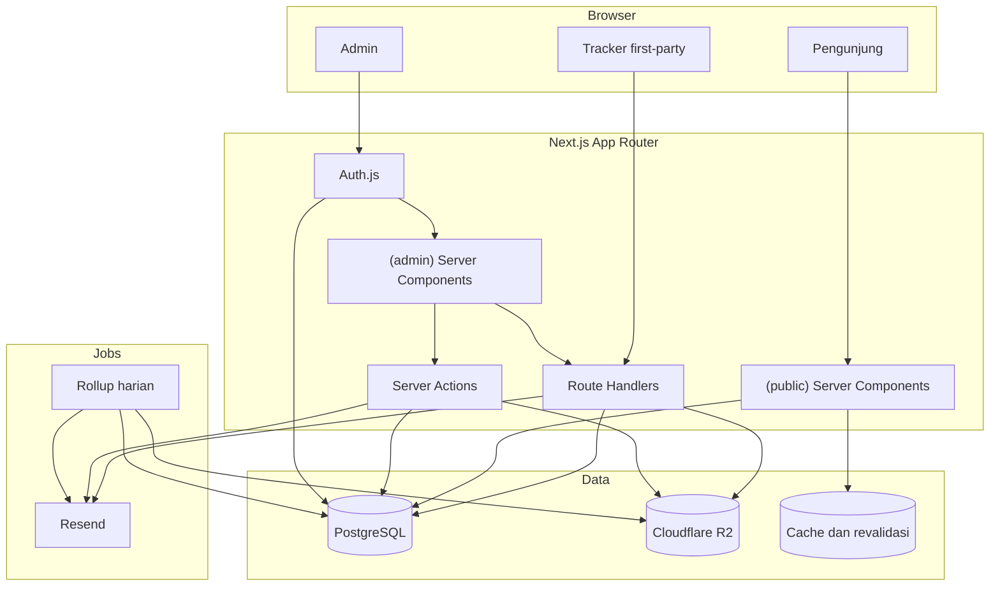
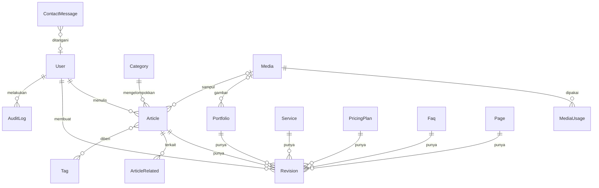

# Dokumentasi CMS dan Dashboard Analitik NAIKON

| Field | Nilai |
|---|---|
| Versi | 0.1 |
| Tanggal | 27 Oktober 2026 |
| Pemilik | NAIKON Digital Solution |
| Status | Spesifikasi target, belum diimplementasikan |
| Lingkup | Website NAIKON, satu situs, pemakaian internal |
| Audiens | Admin konten NAIKON, tim engineering NAIKON |
| Bahasa | Indonesia |

## Ringkasan

Dokumen ini menjelaskan CMS dan Dashboard Analitik yang akan dibangun untuk website NAIKON. CMS mengelola konten yang saat ini masih ditulis langsung di `src/features/*/data/*.tsx`. Dashboard Analitik mengukur performa halaman publik, termasuk enam route yang ada, halaman detail artikel, halaman kebijakan privasi, klik CTA, pengiriman formulir, dan performa konten.

Keduanya berada di `/admin` dengan satu login dan tema gelap tetap. Dashboard dipakai tim NAIKON untuk membaca perilaku pengunjung dan mengevaluasi konten. Dashboard tidak dibuka untuk klien dan tidak mendukung multi-site pada fase ini.

`Katalog Produk dan Jasa.md` memakai istilah Dashboard Analitik untuk panel yang dijual ke klien. Dokumen ini memakai istilah yang sama untuk panel internal NAIKON. Lingkupnya berbeda: satu situs, tanpa akun klien, tanpa white-label.

Dokumen ini bukan panduan untuk fitur yang sudah berjalan. CMS dan Dashboard Analitik belum ada di repo. Isi dokumen adalah spesifikasi target, keputusan teknis, dan panduan penggunaan yang akan berlaku setelah implementasi.

Stack target:

- Next.js 16 App Router, React 19, TypeScript
- Tailwind CSS v4
- PostgreSQL dan Prisma
- Auth.js
- Zod
- Cloudflare R2 untuk media
- Recharts untuk grafik
- Resend untuk email transaksional

## Cara membaca dokumen ini

Dokumen dibagi menjadi analisis awal, dua bagian, dan empat lampiran.

- **Bagian A** untuk admin konten dan pemilik website. Isinya panduan memakai CMS dan membaca Dashboard Analitik. Tidak perlu memahami kode.
- **Bagian B** untuk tim engineering. Isinya arsitektur, model data, route, keamanan, dan rencana implementasi.
- **Lampiran** berisi glosarium, peta file frontend, checklist acceptance, dan changelog.

Kalau Anda hanya perlu mengelola konten, baca Bagian A. Kalau Anda akan menulis kode atau meninjau arsitektur, baca Bagian B setelah Bagian A.

## Status saat ini

| Area | Kondisi saat ini | Dampak |
|---|---|---|
| Frontend publik | Enam route, semua halaman dirender komponen client, data hardcoded | CMS perlu sumber data baru dan server component |
| Formulir | Simulasi `setTimeout(900)`, data tidak dikirim | Konversi formulir belum bisa diukur |
| WhatsApp | Belum ada link `wa.me` | Klik WhatsApp belum bisa dilacak |
| Blog | Hanya tiga preview, belum ada `/blog/[slug]` | Artikel belum punya halaman detail dan event baca |
| Analytics | Belum ada tracker, event, atau penyimpanan | Dashboard belum punya data |
| Admin | Belum ada `/admin`, autentikasi, atau RBAC | CMS belum punya pintu masuk |
| Media | Gambar disimpan di `public/` dan diimpor langsung | Belum ada media library |
| Database | Belum ada | Konten dan analytics belum punya tempat penyimpanan |
| Aturan repo | `.agents/rules` masih berisi aturan Laravel 13 | Tidak sesuai stack Next.js, perlu diganti |

Enam route publik yang ada:

| Route | Komponen halaman | Isi |
|---|---|---|
| `/` | `HomePage` | Hero, profil, layanan, workflow, portofolio, paket harga, FAQ, kontak |
| `/tentang-kami` | `AboutPage` | Hero, profil perusahaan, nilai, visi dan misi |
| `/layanan` | `ServicesPage` | Hero, empat layanan, enam paket harga, workflow |
| `/portofolio` | `PortfolioPage` | Hero, enam studi kasus, CTA |
| `/blog` | `BlogPage` | Hero, tiga preview artikel, callout |
| `/kontak` | `ContactPage` | Hero, kanal kontak, formulir konsultasi |

## Analisis frontend yang ada

Bagian ini merangkum kondisi frontend yang menjadi acuan desain CMS dan Dashboard Analitik.

### Arsitektur

- Next.js 16.4.2 App Router, React 19.3, TypeScript, Tailwind CSS v4, dan Radix Icons.
- `src/app/*/page.tsx` hanya me-render halaman dari `src/features/*/pages`.
- `Navbar` dan `Footer` dirender di setiap halaman, bukan di layout publik.
- Lima dari enam halaman punya `metadata` statis di `src/app/*/page.tsx`. Beranda belum punya metadata sendiri. Belum ada metadata dinamis dari database.
- Semua halaman publik dirender oleh komponen `"use client"` di `src/features/*/pages`.
- State tema dibaca dari `localStorage` dengan kunci `nk-theme-preference`, dan kodenya diulang di enam halaman.
- Belum ada API, database, autentikasi, atau server action.
- Formulir kontak dan konsultasi memakai `setTimeout(900)` lalu menampilkan pesan sukses. Tidak ada data yang dikirim.
- Belum ada tautan `wa.me`. Satu-satunya tautan kontak adalah `mailto:contact@naykon.id`.
- Belum ada `/blog/[slug]`, sehingga artikel belum punya halaman detail.
- Belum ada tracker analytics.
- Gambar `public/portfolio/finops-dashboard.jpg` adalah mockup studi kasus portofolio, bukan tangkapan layar Dashboard Analitik NAIKON.

### Sistem desain publik

| Token | Nilai dominan di komponen | Pemakaian |
|---|---|---|
| Aksen | `#0066FF` | Tombol, tautan, badge |
| Ink | `#041E42` | Judul dan teks utama |
| Muted | `#4A5D78` | Teks sekunder |
| Border | `#E6F0FD` | Garis kartu dan field |
| Latar gelap | `#030711` | Body mode gelap |
| Permukaan gelap | `#0B1730` | Kartu mode gelap |

Catatan: sebagian komponen memakai `dark:bg-slate-900` (sekitar `#0F172A`) alih-alih `--surface: #0B1730`. Dua warna ini berdekatan, tetapi tidak sama. Samakan sebelum CMS masuk supaya warna kartu tidak bercabang.

Pola yang dipakai:

- Tema publik ditentukan oleh preferensi tersimpan `nk-theme-preference` dan diterapkan lewat class `.theme-dark` serta CSS variable di `src/app/globals.css`. Saat ini tidak ada tombol untuk mengubah preferensi itu; halaman hanya membacanya.
- Kartu memakai radius 24 sampai 26 px, border tipis, dan bayangan lembut.
- Lebar konten dominan 1240 px, termasuk navbar dan footer. `globals.css` juga mendefinisikan `.page-width` 1200 px, tetapi class itu tidak dipakai komponen.
- Komponen global: `Navbar`, `Footer`, dan `ScrollReveal`.
- Animasi masuk memakai `IntersectionObserver` dan menghormati `prefers-reduced-motion`.

Selain itu, `globals.css` mendefinisikan `--accent: #0869e8`, `--ink: #102651`, `--muted: #425776`, dan `--line: #d5e1ef`, sementara banyak komponen memakai `#0066FF`, `#041E42`, `#4A5D78`, dan `#E6F0FD`. Pasangan nilai ini mirip, tetapi tidak sama. CMS sebaiknya memakai satu set token saja supaya warna admin dan publik tidak bercabang.

### Duplikasi data

| Data | Lokasi 1 | Lokasi 2 | Akibat |
|---|---|---|---|
| Layanan | `servicesData.tsx` | `homeData.tsx` | Dua versi bisa berbeda |
| Portofolio | `portfolioData.tsx` | `homeData.tsx` | Item dan urutan bisa berbeda |
| Paket harga | `homeData.tsx` | Dipakai `PricingSection.tsx` dan `ServicePricing.tsx` | Satu sumber, tetapi berada di file beranda sehingga sulit ditemukan |
| Kontak | `contactData.tsx` | `Footer.tsx` | Email dan jam kerja bisa tidak sinkron |
| Navigasi | `Navbar.tsx` | `Footer.tsx` | Label dan tautan bisa berbeda |

CMS harus menjadikan setiap data satu baris di database. Halaman beranda dan halaman domain membaca baris yang sama.

### Dampak ke CMS dan analytics

- CMS tidak bisa hanya menambah halaman admin di atas data hardcoded. Sumber data harus pindah ke database lebih dulu.
- Analytics tidak bisa mengukur formulir sebelum formulir punya endpoint yang menyimpan data.
- Analytics tidak bisa mengukur klik WhatsApp sebelum tautan `wa.me` dipasang.
- Analytics tidak bisa mengukur artikel dibaca sebelum `/blog/[slug]` ada.
- Refactor ke Server Component dibutuhkan supaya halaman publik bisa di-cache, data dibaca di server, dan metadata dinamis dibuat dari database.

---

# Bagian A: Panduan Pengguna

## 1. Pengenalan

### 1.1 Siapa yang memakai

CMS dipakai oleh tim NAIKON, bukan oleh klien. Ada empat kelompok pemakai:

| Kelompok | Pekerjaan utama | Akses |
|---|---|---|
| Admin | Mengelola pengguna, pengaturan situs, dan semua konten | Penuh |
| Editor | Menulis, menyunting, dan menerbitkan konten | Konten, media, pesan, analitik |
| Viewer | Melihat konten, pesan, dan analitik | Konten, media, pesan, analitik |
| Analyst | Membaca analitik dan pesan | Analitik dan pesan |

Dashboard Analitik dipakai oleh pemilik website NAIKON, tim pemasaran, dan tim engineering. Pembaca dashboard tidak perlu bisa menyunting konten. Karena itu izin analitik dipisahkan dari izin konten.

### 1.2 Apa yang bisa dilakukan

Lewat CMS:

- Menulis artikel dan menyimpannya sebagai draf.
- Mengubah portofolio, layanan, paket harga, FAQ, dan halaman Tentang Kami tanpa menyentuh kode.
- Mengunggah gambar ke media library lalu memakainya di beberapa konten.
- Mengatur judul, deskripsi, dan gambar berbagi untuk mesin pencari.
- Melihat pratinjau konten sebelum terbit.
- Menjadwalkan terbit.
- Membaca pesan dari formulir kontak.
- Melihat audit log perubahan, khusus Admin.

Lewat Dashboard Analitik:

- Melihat jumlah pengunjung, pageview, dan sesi.
- Melihat halaman yang paling sering dibuka.
- Melihat asal trafik: pencarian, langsung, sosial, dan rujukan.
- Melihat jenis perangkat yang dipakai pengunjung.
- Melihat klik CTA, klik WhatsApp setelah tombolnya dipasang, dan pengiriman formulir.
- Melihat performa tiap artikel, portofolio, layanan, dan paket harga.
- Mengunduh data dalam bentuk CSV.

### 1.3 Istilah dasar

| Istilah | Arti di dokumen ini |
|---|---|
| Pageview | Satu kali halaman dibuka; muat ulang dalam 2 detik tidak dihitung dua kali |
| Pengunjung unik | Perkiraan jumlah orang berbeda, dihitung dari hash harian. Untuk rentang panjang, angkanya bukan orang unik sepanjang rentang. |
| Sesi | Rangkaian pageview dari satu pengunjung dalam 30 menit tanpa jeda |
| Bounce | Sesi yang hanya berisi satu pageview |
| CTA | Tombol atau tautan yang mengajak pengunjung melakukan tindakan, misalnya "Konsultasi" |
| Konversi | Tindakan bernilai bisnis: klik CTA, klik WhatsApp, atau kirim formulir |
| UTM | Parameter di URL untuk menandai sumber kampanye |
| Rollup | Ringkasan agregat harian atau bulanan yang dihitung dari event mentah |
| Draf | Konten yang belum terbit dan hanya terlihat di admin |
| Revisi | Salinan konten pada satu titik waktu |

## 2. Masuk, peran, dan izin

### 2.1 Peran

Ada empat peran. Satu pengguna hanya punya satu peran.

| Peran | Bisa melihat | Bisa mengubah | Tidak bisa |
|---|---|---|---|
| Admin | Semua modul | Semua konten, pengguna, pengaturan | Tidak ada batasan modul |
| Editor | Konten, media, pesan, analitik | Konten, unggahan media, dan status pesan | Mengelola pengguna, pengaturan situs, serta menghapus konten, media, atau pesan |
| Viewer | Konten, media, pesan, analitik | Tidak ada | Semua perubahan |
| Analyst | Analitik dan pesan | Tidak ada | Konten, media, pengguna, pengaturan |

Peran `Analyst` berguna kalau ada orang yang hanya perlu membaca angka tanpa ikut menyunting artikel.

### 2.2 Login

1. Buka `https://naykon.id/admin`.
2. Masukkan email dan password.
3. Klik **Masuk**.
4. Kalau berhasil, Anda diarahkan ke `/admin` atau ke halaman terakhir yang Anda buka.

Aturan login:

- Email harus terdaftar dan aktif.
- Password minimal 12 karakter.
- Setelah lima kali gagal dalam 15 menit, akun dikunci sementara selama 15 menit.
- Sesi berakhir setelah 8 jam. Selama ada aktivitas, masa berlaku diperbarui maksimal sekali per jam.
- Login dari perangkat baru mengirim notifikasi email.

Tidak ada pendaftaran mandiri. Akun dibuat oleh Admin lewat menu **Pengguna**.

### 2.3 Lupa password

1. Klik **Lupa password** di halaman login.
2. Masukkan email.
3. Buka email dari NAIKON dan klik tautan reset.
4. Tautan berlaku 60 menit dan hanya bisa dipakai sekali.
5. Buat password baru, lalu login.

Kalau email tidak masuk dalam 10 menit, periksa folder spam. Kalau tetap tidak ada, hubungi Admin. Jangan membuat akun baru dengan email berbeda.

### 2.4 Sesi dan logout

- Sesi berakhir otomatis setelah 8 jam sejak pembaruan terakhir.
- Klik nama Anda di kanan atas, lalu **Keluar**.
- Keluar dari satu perangkat tidak mengakhiri sesi di perangkat lain.
- Admin bisa mengakhiri semua sesi satu pengguna lewat halaman detail pengguna.

### 2.5 Tabel izin

| Tindakan | Admin | Editor | Viewer | Analyst |
|---|---|---|---|---|
| Melihat daftar konten | Ya | Ya | Ya | Tidak |
| Membuat dan menyunting konten | Ya | Ya | Tidak | Tidak |
| Menerbitkan konten | Ya | Ya | Tidak | Tidak |
| Menghapus konten | Ya | Tidak | Tidak | Tidak |
| Mengelola kategori dan tag | Ya | Ya | Tidak | Tidak |
| Melihat dan memulihkan revisi | Ya | Ya | Tidak | Tidak |
| Melihat media | Ya | Ya | Ya | Tidak |
| Mengunggah dan memakai media | Ya | Ya | Tidak | Tidak |
| Menghapus media | Ya | Tidak | Tidak | Tidak |
| Membaca pesan kontak | Ya | Ya | Ya | Ya |
| Mengubah status pesan | Ya | Ya | Tidak | Tidak |
| Menghapus pesan | Ya | Tidak | Tidak | Tidak |
| Melihat analitik | Ya | Ya | Ya | Ya |
| Mengekspor CSV | Ya | Ya | Tidak | Ya |
| Mengelola pengguna | Ya | Tidak | Tidak | Tidak |
| Mengubah pengaturan situs | Ya | Tidak | Tidak | Tidak |
| Melihat audit log | Ya | Tidak | Tidak | Tidak |

Izin diperiksa di server pada setiap permintaan. Menyembunyikan tombol di layar bukan pengaman. Kalau Anda mencoba membuka URL yang tidak diizinkan, server menolak dan menampilkan halaman 403.

## 3. Dashboard admin

### 3.1 Struktur navigasi

Sidebar admin memakai tema gelap tetap. Tidak ada tombol ganti tema di area admin. Ini disengaja supaya area kerja terasa berbeda dari situs publik dan supaya warna grafik tidak berubah makna.

```text
/admin
├── Ringkasan
├── Analitik
│   ├── Ikhtisar
│   ├── Halaman
│   ├── Sumber Trafik
│   ├── Konversi
│   ├── Performa Konten
│   ├── Real-time
│   └── Laporan
├── Konten
│   ├── Artikel
│   ├── Kategori
│   ├── Tag
│   ├── Portofolio
│   ├── Layanan
│   ├── Paket Harga
│   ├── FAQ
│   ├── Halaman
│   └── Media
├── Pesan
├── Pengguna
├── Pengaturan
│   ├── Situs
│   ├── Navigasi
│   ├── Kontak
│   └── Analytics
└── Audit
```

Sidebar bisa diciutkan menjadi ikon saja. Pilihan itu disimpan di browser, bukan di database. Di bawah 1024 px, sidebar menjadi drawer yang dibuka lewat tombol menu. Tabel lebar bisa digulir horizontal dan kolom aksi tetap terlihat.

Item sidebar yang tidak diizinkan untuk peran pengguna tidak ditampilkan. Ini hanya kenyamanan; server tetap menolak akses langsung ke URL tersebut.

### 3.2 Halaman Ringkasan

Halaman `/admin` adalah titik masuk setelah login. Isinya:

- Empat kartu angka: artikel terbit, draf, pesan baru, dan pengunjung 7 hari terakhir.
- Daftar lima konten yang terakhir diubah, lengkap dengan nama pengubah dan waktu.
- Daftar lima pesan terbaru yang belum dibaca.
- Peringatan kalau ada konten terjadwal yang gagal terbit atau media yang gagal diunggah.

Ringkasan tidak menampilkan grafik besar. Grafik ada di modul Analitik supaya halaman ini tetap cepat dibuka. Isi Ringkasan mengikuti izin: tanpa `content.view`, kartu jumlah artikel, daftar konten, dan peringatan konten disembunyikan; tanpa `messages.view`, kartu pesan baru dan daftar pesan disembunyikan; tanpa `analytics.view`, kartu pengunjung disembunyikan.

### 3.3 Tema gelap

Palet admin:

| Token | Nilai | Pemakaian |
|---|---|---|
| Latar halaman | `#030711` | Body |
| Permukaan | `#0B1730` | Card, sidebar, tabel |
| Permukaan naik | `#12213F` | Dropdown, modal, hover |
| Garis | `#1E3358` | Border, pemisah |
| Teks utama | `#F1F5FB` | Judul, angka |
| Teks sekunder | `#94A7C4` | Label, keterangan |
| Aksen | `#2563EB` | Tombol utama dengan teks putih |
| Aksen grafik | `#3B82F6` | Garis grafik dan batang |
| Aksen tautan | `#60A5FA` | Tautan teks, ikon aktif |
| Aksen terang | `#38BDF8` | Garis pembanding, fokus |
| Sukses | `#34D399` | Delta positif, status terbit |
| Peringatan | `#FBBF24` | Draf, jadwal |
| Bahaya | `#F87171` | Hapus, gagal, delta negatif |

Aturan warna:

- Jangan memakai merah dan hijau sebagai satu-satunya pembeda. Selalu sertakan ikon atau teks.
- Kontras teks minimal 4.5:1 terhadap latar.
- Grafik memakai biru dan cyan. Warna lain hanya untuk menandai status.
- Fokus keyboard memakai outline `#38BDF8` setebal 2 px dengan offset 2 px.

### 3.4 Pola interaksi umum

**Tabel**

- Kolom bisa diurutkan dengan klik judul kolom.
- Pencarian memakai kotak di atas tabel, bukan filter tersembunyi.
- Filter aktif tampil sebagai chip yang bisa dihapus satu per satu.
- Pagination menampilkan jumlah baris dan pilihan 10, 25, atau 50.
- Aksi baris ada di menu titik tiga di kolom paling kanan.

**Formulir**

- Simpan otomatis berjalan setiap 30 detik untuk draf.
- Tombol **Simpan draf** dan **Terbitkan** dipisah.
- Kalau ada perubahan yang belum disimpan, berpindah halaman memunculkan konfirmasi.
- Galat validasi tampil di bawah field yang bermasalah, bukan hanya di atas formulir.
- Tombol submit menampilkan status memproses dan tidak bisa diklik dua kali.

**Penghapusan**

- Menghapus konten memakai soft delete. Baris tidak tampil di daftar default dan dihapus permanen setelah 30 hari.
- Konfirmasi menyebut judul konten, bukan hanya "item ini".
- Admin bisa memulihkan konten terhapus sebelum 30 hari lewat filter **Terhapus**.
- Admin bisa memulihkan konten berstatus Arsip lewat filter status **Arsip** di daftar konten.

**Notifikasi**

- Notifikasi singkat muncul di kanan bawah dan hilang setelah 5 detik.
- Notifikasi galat tetap sampai ditutup.
- Riwayat notifikasi tidak disimpan. Kalau perlu jejak permanen, lihat Audit.

### 3.5 Aksesibilitas

- Semua aksi bisa dilakukan dengan keyboard.
- Modal menahan fokus di dalam sampai ditutup.
- Tombol ikon selalu punya label untuk pembaca layar.
- Tabel memakai header yang benar, bukan div yang ditata seperti tabel.
- Setiap grafik punya ringkasan teks dan tabel data yang bisa dibuka, supaya angka tidak hanya disampaikan lewat warna atau posisi.
- Animasi dibatasi 200 ms dan dimatikan kalau pengguna memilih reduced motion.

## 4. Modul konten

### 4.1 Artikel

Artikel adalah konten blog. Saat ini `/blog` hanya menampilkan tiga preview dari `blogData.tsx`. Setelah CMS berjalan, daftar artikel dibaca dari database dan setiap artikel punya halaman detail di `/blog/[slug]`.

Field artikel:

| Field | Wajib | Keterangan |
|---|---|---|
| Judul | Ya | Maksimal 120 karakter |
| Slug | Ya | Dibuat otomatis dari judul, bisa diubah sebelum terbit |
| Ringkasan | Ya | Maksimal 240 karakter, dipakai di kartu blog |
| Isi | Ya | Editor teks kaya, minimal satu paragraf |
| Kategori | Ya | Satu kategori per artikel; default `Umum` |
| Tag | Tidak | Bisa lebih dari satu |
| Gambar sampul | Ya saat terbit atau terjadwal | Rasio 16:9, minimal 1200 x 675 px |
| Alt gambar | Ya saat terbit atau terjadwal | Deskripsi singkat untuk pembaca layar |
| Penulis | Ya | Diambil dari pengguna yang membuat |
| Status | Ya | Draf, review, terjadwal, terbit, arsip |
| Tanggal terbit | Ya jika terbit | Diisi otomatis saat status menjadi Terbit |
| Jadwal terbit | Ya jika terjadwal | Waktu di masa depan, zona `Asia/Jakarta` |
| SEO title | Tidak | Kalau kosong, memakai judul |
| SEO description | Tidak | Kalau kosong, memakai ringkasan |
| Artikel terkait | Tidak | Maksimal tiga |

Aturan:

- Slug unik. Kalau sudah dipakai, sistem menambahkan akhiran angka.
- Mengubah slug artikel yang sudah terbit membuat pengalihan 301 dari slug lama.
- Artikel tanpa gambar sampul tidak bisa diterbitkan atau dijadwalkan.
- Kalau kategori tidak dipilih, sistem memakai `Umum`, yang dibuat otomatis saat instalasi.

### 4.2 Kategori dan tag

Kategori mengelompokkan artikel. Tag menandai topik yang lebih spesifik. Keduanya dikelola di **Konten > Kategori** dan **Konten > Tag**.

| Field | Kategori | Tag |
|---|---|---|
| Nama | Wajib | Wajib |
| Slug | Wajib, unik | Wajib, unik |
| Deskripsi | Opsional | Tidak ada |
| Warna label | Opsional | Tidak ada |
| Urutan | Bisa diatur | Tidak ada |

Menghapus kategori yang masih punya artikel ditolak. Pindahkan artikel ke kategori lain lebih dulu. Menghapus tag hanya melepas label dari artikel, tidak menghapus artikel.

### 4.3 Media

Media library menyimpan gambar dan dokumen. File disimpan di Cloudflare R2, bukan di `public/`.

Cara mengunggah:

1. Buka **Konten > Media**.
2. Klik **Unggah** atau tarik file ke area unggah.
3. Tunggu sampai status selesai.
4. Isi alt text. Untuk gambar dekoratif, centang **Gambar dekoratif**.
5. Klik **Simpan**.

Batasan:

- Gambar: JPG, PNG, WebP, AVIF. Maksimal 5 MB.
- Dokumen: PDF. Maksimal 10 MB.
- Nama file diubah menjadi slug dan diberi akhiran unik. Nama asli tetap disimpan sebagai metadata.
- Setiap gambar membuat versi WebP dan ukuran 400, 800, dan 1600 px.
- File yang dipakai konten tidak bisa dihapus. Sistem memeriksa sampul, gambar portofolio, dan catatan `MediaUsage` untuk gambar di dalam isi konten, lalu menampilkan daftar konten yang memakainya.

Alt text wajib untuk gambar yang bermakna. Alt text tidak boleh mengulang judul konten dan tidak boleh diawali "gambar".

### 4.4 Portofolio

Portofolio mengisi `/portofolio` dan bagian studi kasus di beranda. Saat ini datanya ada di dua tempat: `portfolioData.tsx` dan `homeData.tsx`. Setelah CMS berjalan, hanya ada satu sumber data.

Field portofolio:

| Field | Wajib | Keterangan |
|---|---|---|
| Judul proyek | Ya | Nama proyek, bukan nama klien |
| Slug | Ya | Untuk halaman detail di masa depan |
| Kategori | Ya | Web app, website, atau mobile |
| Sektor klien | Ya | Misalnya logistik, pendidikan, kesehatan |
| Ringkasan | Ya | Maksimal 240 karakter |
| Deskripsi | Ya | Masalah, solusi, dan hasil |
| Teknologi | Ya | Minimal satu |
| Dampak | Ya | Satu kalimat hasil, kuantitatif kalau datanya ada |
| Metrik | Tidak | Angka pendukung, harus berasal dari data nyata |
| Gambar | Ya saat terbit atau terjadwal | Rasio 4:3 |
| Alt gambar | Ya saat terbit atau terjadwal | |
| Urutan tampil | Ya | Angka kecil tampil lebih dulu |
| Sorot di beranda | Tidak | Maksimal tiga item |
| Status | Ya | Mengikuti alur status di Bagian 5 |

Aturan metrik: angka dampak hanya boleh diisi kalau tim punya sumbernya. Jangan mengarang persentase atau jumlah pengguna. Kalau data belum ada, kosongkan field metrik.

Saat status terbit atau terjadwal, gambar dan alt wajib. Aturan ini dicek di server, bukan hanya di form.

### 4.5 Layanan

Layanan mengisi `/layanan` dan bagian layanan di beranda.

| Field | Wajib | Keterangan |
|---|---|---|
| Nama layanan | Ya | |
| Slug | Ya | |
| Kategori | Ya | Website, penyegaran, sistem, mobile |
| Deskripsi singkat | Ya | Maksimal 200 karakter |
| Deskripsi lengkap | Ya | |
| Daftar fitur | Ya | Ditampilkan sebagai tag |
| Ikon | Ya | Dipilih dari set ikon yang tersedia |
| Teks CTA | Ya | Misalnya "Konsultasi Pembuatan Web" |
| Tujuan CTA | Ya | URL internal atau pesan WhatsApp |
| Urutan | Ya | |
| Status | Ya | Mengikuti alur status di Bagian 5 |

Ikon dibatasi pada set yang sudah dipakai frontend, yaitu ikon Radix. Admin memilih dari daftar, tidak mengunggah SVG. Ini mencegah ikon asing merusak tampilan dan mencegah SVG berisi skrip.

### 4.6 Paket harga

Paket harga mengisi bagian pricing di beranda dan `/layanan`. Data saat ini ada di `homeData.tsx` dan dipakai ulang oleh `ServicePricing.tsx`.

| Field | Wajib | Keterangan |
|---|---|---|
| Nama paket | Ya | |
| Label harga | Ya | Teks bebas, misalnya "Mulai dari Rp 2,5 juta" |
| Catatan harga | Tidak | Misalnya "belum termasuk domain" |
| Deskripsi | Ya | Satu kalimat |
| Daftar fitur | Ya | Urut, minimal tiga |
| Badge | Tidak | Misalnya "Paling Populer" |
| Teks CTA | Ya | |
| Tujuan CTA | Ya | |
| Urutan | Ya | |
| Status | Ya | Mengikuti alur status di Bagian 5 |

Harga disimpan sebagai teks, bukan angka, karena katalog NAIKON memakai frasa "mulai dari" dan harga bisa berubah per proyek. Kalau nanti dibutuhkan perhitungan, tambahkan field angka terpisah dan jangan mengubah field teks yang sudah dipakai.

Hanya satu paket yang boleh memakai badge "Paling Populer". Kalau admin menandai paket kedua, sistem meminta konfirmasi untuk melepas badge dari paket sebelumnya.

### 4.7 FAQ

| Field | Wajib | Keterangan |
|---|---|---|
| Pertanyaan | Ya | |
| Jawaban | Ya | Teks biasa, maksimal 600 karakter |
| Kategori | Tidak | Misalnya harga, proses, dukungan |
| Urutan | Ya | |
| Status | Ya | Mengikuti alur status di Bagian 5 |

FAQ yang terbit otomatis masuk ke data terstruktur `FAQPage` di halaman yang menampilkannya.

### 4.8 Halaman Tentang Kami

Halaman ini lebih jarang berubah, tetapi tetap perlu bisa disunting.

Bagian yang bisa diubah:

- Judul dan subjudul hero.
- Teks profil perusahaan.
- Tiga kartu pendekatan kerja.
- Visi dan misi.
- Foto tim dan alt text.
- Judul dan deskripsi untuk mesin pencari.
- Angka atau fakta perusahaan, kalau ada dan bisa diverifikasi.

Bagian yang tidak diubah dari editor halaman ini:

- Struktur navigasi utama, diatur di **Pengaturan > Navigasi**.
- Footer, memakai data dari **Pengaturan > Navigasi** dan **Pengaturan > Kontak**.

### 4.9 Pengaturan situs

**Situs**

- Nama situs
- Deskripsi default
- Logo terang dan logo gelap
- Favicon
- Gambar berbagi default
- URL kanonik
- Bahasa

**Navigasi**

- Urutan item menu
- Label
- URL tujuan
- Apakah tampil di header, footer, atau keduanya
- Status aktif

**Kontak**

- Email resmi
- Nomor WhatsApp dalam format internasional
- Jam kerja
- Alamat, kalau dipublikasikan
- Tautan media sosial

**Analytics**

- Status tracker aktif atau nonaktif
- Daftar IP kantor yang dikecualikan, disimpan di pengaturan dan tidak dicampur ke event analytics
- Lama retensi data, ditampilkan sebagai informasi dan mengikuti tingkat yang aktif. Tidak bisa diubah dari UI.
- Email penerima laporan bulanan

Perubahan pengaturan situs langsung memengaruhi halaman publik setelah revalidasi. Perubahan kontak dan navigasi tidak perlu build ulang aplikasi; cukup revalidasi cache.

### 4.10 Pesan kontak

Formulir di `/kontak` dan formulir konsultasi di beranda saat ini hanya simulasi. Setelah backend berjalan, setiap kiriman masuk ke menu **Pesan**.

Isi pesan:

- Nama
- Email
- Jenis layanan yang dipilih
- Isi pesan
- Halaman asal formulir
- Waktu masuk
- Status: baru, dibaca, dibalas, spam
- Catatan internal

Tindakan:

- Tandai sudah dibaca.
- Tandai sudah dibalas.
- Tandai spam.
- Tambahkan catatan.
- Buka balasan di klien email lewat tautan `mailto:`.
- Hapus permanen, khusus Admin.

Formulir dilindungi rate limit dan honeypot. Kiriman yang lolos sebagai spam tetap disimpan 30 hari sebelum dihapus, supaya bisa diperiksa kalau ada laporan pesan hilang.

### 4.11 Pengguna

Admin dapat:

- Membuat pengguna dengan email dan peran.
- Mengirim ulang undangan.
- Mengubah peran.
- Menonaktifkan akun.
- Mengakhiri semua sesi dengan menaikkan `sessionVersion`.
- Melihat waktu login terakhir.

Admin tidak bisa menghapus akunnya sendiri. Minimal harus ada satu Admin aktif. Perubahan peran dicatat di audit log.

### 4.12 Audit log

Audit mencatat tindakan yang mengubah data atau mengambil data dalam jumlah besar:

- Konten dibuat, disunting, diterbitkan, diarsipkan, atau dihapus.
- Media diunggah atau dihapus.
- Pengguna dibuat, diubah perannya, atau dinonaktifkan.
- Pengaturan situs diubah.
- Pesan dihapus.
- Ekspor CSV analytics.

Satu baris audit berisi waktu, pengguna, jenis tindakan, jenis objek, ID objek, dan ringkasan perubahan. Nilai field yang sensitif tidak disimpan di audit.

Audit disimpan 12 bulan. Audit tidak bisa disunting atau dihapus lewat UI.

## 5. Alur publikasi dan revisi

### 5.1 Status konten

Transisi status yang diizinkan:

| Dari | Ke | Siapa |
|---|---|---|
| Draf | Review | Editor, Admin |
| Review | Draf | Editor, Admin |
| Review | Terjadwal atau Terbit | Editor, Admin |
| Terjadwal | Terbit | Sistem |
| Terjadwal | Review | Sistem, kalau penerbitan gagal |
| Terbit | Draf (unpublish) atau Arsip | Editor, Admin |
| Arsip | Draf (pulihkan) | Editor, Admin |

Arti setiap status:

| Status | Arti | Terlihat di publik |
|---|---|---|
| Draf | Masih ditulis, bebas diubah | Tidak |
| Review | Menunggu persetujuan Editor atau Admin | Tidak |
| Terjadwal | Disetujui, menunggu waktu terbit | Tidak |
| Terbit | Tampil di situs | Ya |
| Arsip | Disembunyikan, masih bisa dipulihkan | Tidak |

Semua peran yang bisa menyunting boleh memindahkan Draf ke Review. Hanya Editor dan Admin yang boleh menerbitkan. Viewer dan Analyst tidak bisa mengubah status.

### 5.2 Alur dari draf ke terbit

1. Editor membuat konten baru. Status awal Draf.
2. Editor mengisi field wajib dan menyimpan.
3. Editor membuka pratinjau untuk memeriksa tampilan.
4. Editor mengubah status ke Review dan menulis catatan untuk peninjau.
5. Peninjau, yaitu Editor atau Admin, membuka konten, membaca, lalu memilih:
   - **Setujui dan terbitkan**, atau
   - **Kembalikan ke draf** dengan catatan.
6. Kalau disetujui, konten langsung terbit atau masuk antrean jadwal.
7. Setelah terbit, halaman publik diperbarui lewat revalidasi.

### 5.3 Revisi

Setiap kali artikel, portofolio, layanan, paket harga, FAQ, atau halaman disimpan dalam status terbit, sistem membuat revisi baru. Revisi menyimpan salinan field konten, bukan seluruh database.

Yang bisa dilakukan:

- Melihat daftar revisi dengan waktu dan pengguna.
- Membandingkan dua revisi secara berdampingan.
- Memulihkan revisi lama. Pemulihan membuat revisi baru, bukan menghapus riwayat.

Editor dan Admin bisa melihat dan memulihkan revisi. Viewer dan Analyst tidak.

Revisi lebih dari 90 hari dihapus, tetapi minimal 20 revisi terakhir per konten selalu disimpan.

### 5.4 Pratinjau

Pratinjau membuka halaman publik dengan konten yang belum terbit. Caranya:

1. Klik **Pratinjau** di editor.
2. Halaman terbuka di tab baru pada `/pratinjau/[token]`.
3. Token berlaku 30 menit dan hanya untuk konten tersebut.

Halaman pratinjau tidak diindeks mesin pencari dan tidak mengirim event analytics.

### 5.5 Jadwal terbit

- Isi tanggal dan waktu di zona `Asia/Jakarta`.
- Konten berstatus Terjadwal akan terbit dalam 5 menit setelah waktunya.
- Kalau gagal, status kembali ke Review dan muncul peringatan di Ringkasan.
- Menjadwalkan ulang tidak membuat revisi baru.

### 5.6 Unpublish, arsip, dan hapus

- **Unpublish** mengubah status dari Terbit ke Draf. Halaman publik mengembalikan 404 setelah revalidasi.
- **Arsip** mengubah status menjadi Arsip. Konten disembunyikan, slug dan riwayat tetap ada, dan bisa dipulihkan kapan saja.
- **Hapus** memakai soft delete: baris diberi `deletedAt`, tidak tampil di daftar default, dan dihapus permanen setelah 30 hari. Ini berbeda dari Arsip.

### 5.7 Checklist artikel sebelum terbit

Checklist ini berlaku untuk artikel. Portofolio, layanan, paket, FAQ, dan halaman memakai field wajibnya masing-masing di Bagian 4.

- Judul dan slug sudah benar.
- Ringkasan tidak kosong dan tidak mengulang paragraf pertama.
- Gambar sampul ada, alt text terisi.
- Kategori sudah dipilih.
- Tautan di dalam isi sudah dicoba dan tidak ada yang 404.
- SEO title maksimal 60 karakter, description maksimal 160 karakter.
- Pratinjau sudah diperiksa di layar kecil.
- Tidak ada angka, klaim, atau testimoni yang belum diverifikasi.

## 6. Dashboard Analitik

### 6.1 Prinsip

Dashboard ini milik NAIKON dan hanya untuk satu situs. Tujuannya menjawab tiga pertanyaan:

1. Apakah orang menemukan website NAIKON?
2. Konten dan layanan mana yang menarik perhatian?
3. Apakah perhatian itu berubah menjadi kontak?

Dashboard bukan alat profiling. Tidak ada cookie pelacak, tidak ada identitas pengunjung yang bisa dilacak lintas situs, dan analytics tidak menyimpan data pribadi pengunjung dalam bentuk yang bisa dikembalikan menjadi identitas. Data formulir disimpan terpisah di `ContactMessage`.

### 6.2 Halaman dan isi

Sketsa susunan halaman Ikhtisar. Ini gambaran layout, bukan tangkapan layar.

```text
┌──────────────────────────────────────────────────────────────┐
│ Analitik              [30 hari ▼] [Bandingkan] [Ekspor CSV]  │
├─────────┬─────────┬─────────┬─────────┬──────────────────────┤
│ KPI 1   │ KPI 2   │ KPI 3   │ KPI 4   │ KPI 5                │
├─────────┴─────────┴─────────┴─────────┴──────────────────────┤
│ Grafik tren                                                  │
├────────────────────────────────┬─────────────────────────────┤
│ Halaman terpopuler             │ Sumber trafik               │
├────────────────────────────────┼─────────────────────────────┤
│ Perangkat                      │ Real-time                   │
└────────────────────────────────┴─────────────────────────────┘
```

Angka tidak dicantumkan karena dashboard belum berjalan dan belum ada data nyata.

**Ikhtisar**

- Lima kartu KPI: pengunjung unik, pageview, sesi, bounce rate, konversi.
- Grafik area 30 hari.
- Pilihan metrik grafik: pengunjung, pageview, atau konversi.
- Tabel halaman terpopuler.
- Ringkasan sumber trafik.
- Ringkasan perangkat.
- Panel real-time singkat.

Kalau metrik belum aktif pada tingkat yang dipakai, kartu tetap tampil dengan label "Belum aktif" dan tautan ke penjelasan. Jangan menampilkan angka nol untuk metrik yang belum berjalan.

**Halaman**

- Tabel semua halaman dengan pageview, pengunjung unik, bounce, rata-rata durasi, dan klik CTA.
- Halaman masuk dan halaman keluar teratas, dihitung dari event mentah.
- Klik satu baris untuk membuka detail: tren harian, sumber trafik, CTA yang diklik, dan tautan untuk membuka halaman publik.

**Sumber Trafik**

- Pengelompokan: Organic Search, Direct, Social, Referral.
- Daftar referrer teratas.
- Daftar halaman masuk teratas.
- Negara dan kota pengunjung, perkiraan dari IP. Kota bisa meleset, jadi jangan dipakai untuk keputusan operasional.
- Rincian kampanye UTM belum termasuk pada tingkat Menengah. Kalau nanti dibutuhkan, aktifkan tingkat Profesional lalu isi kolom `medium` dan `campaign`.

**Konversi**

- Klik CTA per lokasi: navbar, hero, pricing, portofolio, footer, kontak, artikel.
- Klik WhatsApp.
- Kirim formulir kontak.
- Kirim formulir konsultasi.
- Conversion rate per halaman dan per sumber trafik.
- Catatan status: kalau tombol WhatsApp belum ada di situs, metrik ini menampilkan "Belum aktif", bukan angka nol yang menyesatkan.

**Performa Konten**

- Artikel: pageview, pembaca, persentase baca, klik CTA dari artikel.
- Portofolio: kartu yang terlihat, klik CTA.
- Layanan: kartu yang terlihat, klik CTA.
- Paket harga: berapa kali bagian pricing dilihat, paket mana yang paling sering menjadi titik klik.
- FAQ: pertanyaan yang dibuka.

**Real-time**

- Pengunjung aktif dalam 5 menit terakhir.
- Halaman yang sedang dibuka.
- Sepuluh event terakhir: pageview, CTA click, form submit.
- Diperbarui setiap 15 detik.
- Tidak menampilkan data per pengunjung.

**Laporan**

- Laporan bulanan otomatis dalam bentuk ringkasan teks dan CSV.
- Perbandingan bulan ini dengan bulan sebelumnya.
- Daftar lima halaman teratas, lima konten teratas, dan sumber trafik utama.
- Dikirim ke email penerima pada tanggal 1 setiap bulan.

### 6.3 Metrik per tingkat

Tingkat mengikuti katalog NAIKON. Untuk website NAIKON sendiri, target awal adalah Dasar, lalu Menengah setelah blog dan formulir berjalan. Fitur yang sudah masuk tingkat tetapi belum punya titik UI, seperti klik WhatsApp, kirim formulir, dan pembacaan artikel, ditandai "Belum aktif" sampai titiknya dibuat.

| Kemampuan | Dasar | Menengah | Profesional |
|---|---|---|---|
| Pengunjung unik dan pageview | Ya | Ya | Ya |
| Halaman terpopuler | Ya | Ya | Ya |
| Performa konten | Tidak | Ya | Ya |
| Sumber trafik | Ya | Ya | Ya |
| Perangkat | Ya | Ya | Ya |
| Klik WhatsApp dan kontak yang disepakati | Ya | Ya | Ya |
| Klik CTA | Ya | Ya | Ya |
| Grafik 30 hari | Ya | Ya | Ya |
| Retensi rollup harian | 90 hari | 12 bulan | 24 bulan |
| Kirim formulir | Tidak | Ya | Ya |
| Bounce, durasi sesi, halaman per sesi | Tidak | Ya | Ya |
| Entry dan exit page | Tidak | Ya | Ya |
| Real-time | Tidak | Ya | Ya |
| Lokasi pengunjung | Tidak | Ya | Ya |
| Rentang tanggal khusus | Tidak | Ya | Ya |
| Perbandingan periode | Tidak | Ya | Ya |
| Ekspor CSV | Tidak | Ya | Ya |
| Laporan bulanan | Tidak | Ya | Ya |
| Funnel | Tidak | Tidak | Ya |
| UTM | Tidak | Tidak | Ya |
| Segmentasi | Tidak | Tidak | Ya |
| Multi-site | Tidak | Tidak | Ya |
| API analytics | Tidak | Tidak | Ya |
| Laporan white-label | Tidak | Tidak | Ya |
| Peran dan izin pengguna dashboard | Tidak | Tidak | Ya |

Fitur Profesional tidak masuk lingkup internal NAIKON. Tabel ini disimpan supaya jelas batas antara kebutuhan internal dan fitur yang dijual ke klien. Klik CTA diperlakukan sebagai tindakan kontak yang disepakati, jadi tersedia sejak Dasar untuk kebutuhan internal.

Beberapa metrik Menengah, yaitu entry/exit page serta negara dan kota pengunjung, dihitung dari event mentah. Event mentah disimpan 90 hari, jadi metrik itu hanya tersedia untuk rentang 90 hari terakhir. Untuk rentang 12 bulan, dashboard memakai rollup bulanan yang menyimpan pageview, pengunjung, dan konversi per halaman; bulan berjalan dihitung dari event mentah. Metrik lain ditandai tidak tersedia, bukan diisi nol.

"API analytics" pada tabel berarti API yang dijual ke klien. Endpoint internal dashboard, seperti ekspor CSV dan real-time, bukan produk API dan tetap memakai sesi admin. Baris "Peran dan izin pengguna dashboard" juga merujuk pada akun klien; RBAC internal NAIKON tetap dipakai.

### 6.4 Cara membaca angka

**Pengunjung unik bukan jumlah orang pasti.** Angkanya perkiraan dari hash harian. Orang yang membuka situs dari dua perangkat bisa terhitung dua. Menghapus cookie tidak mengubah apa pun karena tracker tidak memakai cookie, tetapi pergantian jaringan bisa mengubah hash. Untuk rentang sampai 90 hari, angkanya dihitung dengan `COUNT(DISTINCT visitorId)` dari event mentah. Karena hash berubah setiap hari, hasilnya setara dengan menjumlahkan pengunjung unik harian; orang yang kembali di hari lain tetap terhitung lagi. Untuk rentang 12 bulan, dashboard memakai rollup bulanan dan memberi label "pengunjung unik bulanan"; angka bulanan tetap berasal dari hash harian, jadi artinya jumlah pengunjung unik harian dalam bulan itu, bukan orang unik sebulan. Angka antar bulan tidak dijumlahkan, dan tidak ada total 12 bulan.

**Pageview lebih tinggi dari pengunjung unik itu normal.** Satu orang bisa membuka beberapa halaman.

**Bounce rate tinggi belum tentu buruk.** Halaman `/kontak` yang langsung memberi informasi kontak bisa membuat orang pergi tanpa membuka halaman lain. Baca bounce bersama tujuan halaman.

**Delta kecil belum berarti tren.** Bandingkan minimal 7 hari. Perubahan di bawah 5 persen bisa berasal dari fluktuasi harian.

**Angka nol bisa berarti dua hal:** belum ada yang melakukan, atau metriknya belum aktif. Dashboard menandai metrik yang belum aktif secara terpisah.

**Data hari ini belum final.** Angka hari berjalan dihitung langsung dari event mentah dan bisa berubah. Rollup harian pertama berjalan pukul 00:15 WIB, dengan percobaan ulang kalau gagal.

### 6.5 Filter dan perbandingan

- Rentang cepat: 7 hari, 30 hari, 90 hari, 12 bulan.
- Rentang khusus: pilih tanggal mulai dan akhir. Maksimal 366 hari.
- Perbandingan: periode sebelumnya dengan panjang yang sama, atau tahun lalu.
- Filter perangkat: semua, mobile, desktop, tablet.
- Filter sumber: semua, organic, direct, social, referral.
- Filter halaman: pencarian teks, bukan dropdown panjang.

Filter disimpan di URL supaya bisa dibagikan ke rekan kerja. Contoh: `/admin/analitik/ikhtisar?range=30d&compare=previous`.

Untuk rentang 12 bulan, filter perangkat dan sumber dinonaktifkan dengan keterangan, karena rollup bulanan hanya menyimpan data per halaman. Jangan menampilkan filter yang tidak mengubah hasil.

### 6.6 Ekspor

- CSV berisi data yang sedang tampil, termasuk filter.
- Nama file: `naykon-analitik-ikhtisar-2026-10-27.csv`.
- Kolom tanggal memakai format ISO 8601.
- Angka memakai titik desimal supaya konsisten saat diimpor ke alat lain. Kalau dibuka di Excel dengan locale Indonesia, atur pemisah desimal atau impor lewat fitur Data.
- Ekspor maksimal 100.000 baris. Untuk data lebih besar, pakai laporan bulanan.
- Ekspor dicatat di audit karena berisi data performa.

### 6.7 Retensi

| Tingkat | Event mentah | Rollup harian | Rollup bulanan |
|---|---|---|---|
| Dasar | 30 hari | 90 hari | Tidak ada |
| Menengah | 90 hari | 12 bulan | 12 bulan |
| Profesional | 180 hari | 24 bulan | 24 bulan |

Untuk NAIKON, target Menengah: event mentah 90 hari, rollup harian 12 bulan, rollup bulanan 12 bulan.

Retensi berlaku per jenis data. Metrik yang dihitung dari event mentah, seperti pengunjung unik, sesi, bounce, durasi, entry/exit, dan lokasi, hanya tersedia selama event mentah disimpan. Metrik yang dihitung dari rollup tetap tersedia sampai retensi rollup berakhir.

Penghapusan analytics berjalan otomatis; jadwalnya ada di Bagian 14.7. Tidak ada tombol hapus manual untuk analytics. Data mentah tidak menyimpan IP atau identitas langsung; yang tersimpan adalah hash harian yang tidak bisa dibalik.

### 6.8 Batasan dan troubleshooting

| Gejala | Kemungkinan penyebab | Tindakan |
|---|---|---|
| Angka hari ini kosong | Tracker belum menerima event atau query event gagal | Periksa tracker dan `/api/track` |
| Trafik turun drastis | Tracker gagal dimuat atau diblokir | Periksa `/admin/pengaturan/analytics` dan konsol browser |
| Klik CTA tidak tercatat | Tombol baru belum diberi atribut event | Tambahkan `data-track` sesuai Bagian B |
| Form submit selalu nol | Form masih simulasi atau endpoint gagal | Periksa status backend formulir |
| WhatsApp selalu nol | Belum ada tautan `wa.me` | Tambahkan tautan resmi lebih dulu |
| Artikel baru tidak punya halaman detail | Belum ada `/blog/[slug]` | Selesaikan halaman detail artikel |
| Angka real-time tinggi terus | Bot atau health check | Tambahkan IP ke daftar pengecualian |
| CSV kosong | Filter tidak menghasilkan data | Longgarkan filter |

## 7. Batasan dan dukungan

### 7.1 Yang belum termasuk

- Multi-site dan white-label.
- Akun untuk klien.
- Aplikasi native untuk admin.
- Integrasi Google Analytics atau Meta Pixel. Dashboard ini first-party dan sengaja tidak mengirim data ke pihak ketiga.
- Pelacakan lintas perangkat.
- Analitik e-commerce.
- Editor kolaboratif real-time. Dua orang bisa menyunting konten berbeda, tetapi tidak bisa menyunting dokumen yang sama secara bersamaan tanpa konflik.

### 7.2 Kapan menghubungi tim engineering

Hubungi tim kalau:

- Halaman admin menampilkan galat 500 berulang.
- Data analytics berhenti masuk lebih dari 24 jam.
- Ada konten yang hilang setelah disimpan.
- Anda perlu menambah peran atau mengubah aturan izin.
- Anda perlu mengubah struktur field konten.
- Ada indikasi akses tidak sah.

Sertakan waktu kejadian, URL, nama pengguna, dan tangkapan layar. Jangan mengirim password lewat email atau chat.

### 7.3 Dukungan

| Jenis | Saluran | Target respons |
|---|---|---|
| Gangguan produksi | WhatsApp tim internal | 2 jam kerja |
| Permintaan perubahan | Email `contact@naykon.id` | 1 hari kerja |
| Pertanyaan pemakaian | Dokumentasi ini atau tim internal | 1 hari kerja |

Angka di atas adalah target internal, bukan janji SLA kepada klien.

Dokumen ini diperbarui setiap ada perubahan perilaku CMS atau metrik analytics. Nomor versi dan tanggal ada di bagian atas.

---

# Bagian B: Spesifikasi Teknis

## 8. Arsitektur

### 8.1 Prinsip

1. **Server sebagai sumber kebenaran.** Validasi, izin, dan aturan bisnis berjalan di server. Komponen klien hanya mengatur tampilan dan interaksi.
2. **Server Component sebagai default.** Halaman publik dan admin membaca data di server. `"use client"` hanya dipakai untuk komponen yang benar-benar butuh state, efek, atau event browser.
3. **Satu aplikasi.** CMS, situs publik, dan API analytics berada di satu proyek Next.js. Tidak ada backend terpisah.
4. **Konten terstruktur, bukan HTML bebas.** Isi artikel disimpan sebagai dokumen terstruktur, bukan HTML mentah, supaya bisa dirender konsisten dan aman.
5. **Analytics terpisah dari data CMS.** Event pengunjung tidak disimpan di tabel konten dan tidak bisa digabung dengan identitas pengirim formulir.

### 8.2 Diagram komponen



### 8.3 Pembagian tanggung jawab

| Lapisan | Tanggung jawab | Tidak boleh |
|---|---|---|
| Server Component | Membaca data, menyusun halaman, metadata | Menangani event browser |
| Client Component | State UI, form, grafik, interaksi | Mengakses database atau menyimpan rahasia |
| Server Action | Mutasi dari form admin | Dipanggil tanpa pemeriksaan sesi dan izin |
| Route Handler | Endpoint JSON, unggah media, tracking | Mengembalikan data tanpa otorisasi |
| Service layer | Query dan aturan bisnis yang dipakai ulang | Bergantung pada objek request |
| Prisma | Akses database | Berisi aturan izin |

### 8.4 Alur baca halaman publik

```text
Request /layanan
  → Server Component ServicesPage
  → getPublishedServices() di features/services/queries.ts
  → Prisma findMany(status = PUBLISHED, orderBy = sortOrder)
  → render HTML
  → ISR cache 300 detik

Saat admin menyimpan:
  → revalidateTag("services", "max")
```

Halaman publik tidak memakai `"use client"` di level page. Komponen interaktif seperti menu mobile, accordion FAQ, dan logika tema tetap menjadi client component kecil di dalamnya.

### 8.5 Alur tulis dari admin

```text
Form admin
  → Server Action
  → auth() memeriksa sesi
  → requirePermission("content.update")
  → Zod parse input
  → Prisma transaction
  → buat Revision kalau konten berstatus terbit atau dipulihkan
  → tulis AuditLog
  → revalidateTag(tag, "max")
  → redirect dengan notifikasi
```

Server Action tidak boleh diperlakukan sebagai endpoint publik. Setiap action memeriksa sesi dan izin sendiri, meskipun tombolnya hanya muncul untuk peran tertentu.

### 8.6 Alur analytics

```text
page_view / cta_click / form_submit
  → navigator.sendBeacon("/api/track", payload)
  → validasi origin, ukuran, dan skema
  → filter bot
  → hash IP harian
  → insert AnalyticsEvent
  → rollup 00:15 WIB
  → AnalyticsDaily
  → dashboard membaca rollup dan event mentah sesuai metrik
```

Detail ada di Bagian 14 dan 15.

### 8.7 Keputusan arsitektur

| Keputusan | Pilihan | Alasan | Konsekuensi |
|---|---|---|---|
| Framework | Next.js App Router | Sudah dipakai, satu bahasa untuk semua | Tidak ada backend terpisah |
| Database | PostgreSQL | Relasional, kuat untuk agregasi | Perlu koneksi persisten |
| ORM | Prisma | Tipe aman, migrasi jelas | Query agregasi berat perlu SQL mentah |
| Auth | Auth.js | Terintegrasi App Router | Kredensial memakai Prisma langsung, tanpa adapter sesi |
| Validasi | Zod | Skema sama untuk klien dan server | Duplikasi tipe perlu dijaga |
| Media | Cloudflare R2 | Murah, S3-compatible, CDN | Perlu konfigurasi CORS dan signed URL |
| Analytics | First-party | Tanpa cookie, data milik sendiri | Perlu membangun pipeline dan UI |
| Grafik | Recharts | Cocok dengan React, ringan | Aksesibilitas grafik perlu ditambah manual |
| Email | Resend | API sederhana, log pengiriman jelas | Ketergantungan vendor |

## 9. Struktur folder

```text
src/
├── app/
│   ├── (public)/
│   │   ├── layout.tsx
│   │   ├── page.tsx
│   │   ├── tentang-kami/page.tsx
│   │   ├── layanan/page.tsx
│   │   ├── portofolio/page.tsx
│   │   ├── blog/
│   │   │   ├── page.tsx
│   │   │   └── [slug]/page.tsx
│   │   └── kontak/page.tsx
│   ├── (admin)/
│   │   ├── layout.tsx
│   │   ├── forbidden.tsx
│   │   ├── admin/
│   │   │   ├── page.tsx
│   │   │   ├── analitik/
│   │   │   │   ├── ikhtisar/page.tsx
│   │   │   │   ├── halaman/page.tsx
│   │   │   │   ├── sumber-trafik/page.tsx
│   │   │   │   ├── konversi/page.tsx
│   │   │   │   ├── konten/page.tsx
│   │   │   │   ├── real-time/page.tsx
│   │   │   │   └── laporan/page.tsx
│   │   │   ├── konten/
│   │   │   │   ├── artikel/
│   │   │   │   ├── kategori/
│   │   │   │   ├── tag/
│   │   │   │   ├── portofolio/
│   │   │   │   ├── layanan/
│   │   │   │   ├── paket-harga/
│   │   │   │   ├── faq/
│   │   │   │   ├── halaman/
│   │   │   │   └── media/
│   │   │   ├── pesan/
│   │   │   ├── pengguna/
│   │   │   ├── pengaturan/
│   │   │   │   ├── situs/page.tsx
│   │   │   │   ├── navigasi/page.tsx
│   │   │   │   ├── kontak/page.tsx
│   │   │   │   └── analytics/page.tsx
│   │   │   └── audit/
│   ├── (auth)/
│   │   ├── masuk/page.tsx
│   │   ├── lupa-password/page.tsx
│   │   └── reset-password/page.tsx
│   ├── api/
│   │   ├── auth/[...nextauth]/route.ts
│   │   ├── track/route.ts
│   │   ├── media/upload/route.ts
│   │   ├── media/[id]/route.ts
│   │   ├── analytics/export/route.ts
│   │   ├── analytics/realtime/route.ts
│   │   ├── health/route.ts
│   │   └── revalidate/route.ts
│   ├── layout.tsx
│   ├── not-found.tsx
│   ├── sitemap.ts
│   ├── robots.ts
│   └── globals.css
├── components/
│   ├── admin/
│   │   ├── AdminShell.tsx
│   │   ├── Sidebar.tsx
│   │   ├── Topbar.tsx
│   │   ├── DataTable.tsx
│   │   ├── StatCard.tsx
│   │   ├── EmptyState.tsx
│   │   └── charts/
│   ├── public/
│   │   ├── Navbar.tsx
│   │   ├── Footer.tsx
│   │   ├── PublicTheme.tsx
│   │   └── ScrollReveal.tsx
│   └── ui/
├── features/
│   ├── articles/
│   │   ├── components/
│   │   ├── queries.ts
│   │   ├── actions.ts
│   │   ├── schema.ts
│   │   └── types.ts
│   ├── portfolio/
│   ├── services/
│   ├── pricing/
│   ├── faq/
│   ├── pages/
│   ├── media/
│   ├── messages/
│   ├── users/
│   ├── settings/
│   ├── audit/
│   ├── analytics/
│   │   ├── components/
│   │   ├── queries.ts
│   │   ├── rollup.ts
│   │   ├── schema.ts
│   │   └── tracker.ts
│   └── auth/
├── lib/
│   ├── db.ts
│   ├── auth.ts
│   ├── permissions.ts
│   ├── storage.ts
│   ├── email.ts
│   ├── rate-limit.ts
│   ├── audit.ts
│   └── env.ts
├── scripts/
│   ├── bootstrap-admin.ts
│   ├── rollup-analytics.ts
│   ├── seed.ts
│   └── cleanup.ts
└── proxy.ts
```

Catatan:

- `(public)`, `(admin)`, dan `(auth)` adalah route group. Tidak menambah segmen URL.
- Semua kode admin berada di bawah `/admin`. Proxy melindungi seluruh group.
- `features/*/queries.ts` hanya berisi pembacaan data. `actions.ts` hanya berisi mutasi.
- Komponen yang dipakai bersama situs publik dan admin masuk ke `components/ui`, bukan ke salah satu group.
- Route `/kebijakan-privasi` memakai `Page` dan file `(public)/kebijakan-privasi/page.tsx`; tidak digambarkan di pohon di atas agar tetap ringkas.
- Route group `(preview)` berisi `/pratinjau/[token]` dan tidak memuat tracker analytics. Komponen tampilan publik dipakai ulang.

## 10. Model data

### 10.1 Entitas utama



Relasi `Revision` bersifat polimorfik lewat `entityType` dan `entityId`, bukan foreign key. Karena itu tidak ada constraint database yang menghubungkan revisi ke tabel konten tertentu. Validasi `entityType` dilakukan di aplikasi.

### 10.2 Skema Prisma

Skema berikut adalah rancangan awal. Nama field mengikuti bahasa Inggris supaya konsisten dengan kode, sementara label di UI memakai bahasa Indonesia.

```prisma
enum Role {
  ADMIN
  EDITOR
  VIEWER
  ANALYST
}

enum ContentStatus {
  DRAFT
  REVIEW
  SCHEDULED
  PUBLISHED
  ARCHIVED
}

enum MessageStatus {
  NEW
  READ
  REPLIED
  SPAM
}

model User {
  id            String    @id @default(cuid())
  name          String
  email         String    @unique
  emailVerified DateTime?
  image         String?
  passwordHash  String?
  role           Role      @default(VIEWER)
  isActive       Boolean   @default(true)
  sessionVersion Int       @default(0)
  lastLoginAt    DateTime?
  createdAt      DateTime  @default(now())
  updatedAt      DateTime  @updatedAt

  articles  Article[]
  audits    AuditLog[]
  messages  ContactMessage[] @relation("MessageHandler")
  uploads   Media[]         @relation("MediaUploader")
  revisions Revision[]      @relation("RevisionAuthor")

  @@index([role, isActive])
}

model VerificationToken {
  identifier String
  token      String   @unique
  expires    DateTime

  @@unique([identifier, token])
}

model Category {
  id          String   @id @default(cuid())
  name        String
  slug        String   @unique
  description String?
  color       String?
  sortOrder   Int      @default(0)
  createdAt   DateTime @default(now())
  updatedAt   DateTime @updatedAt

  articles Article[]

  @@index([sortOrder])
}

model Tag {
  id        String   @id @default(cuid())
  name      String
  slug      String   @unique
  createdAt DateTime @default(now())
  updatedAt DateTime @updatedAt

  articles Article[] @relation("ArticleTags")
}

model Article {
  id            String        @id @default(cuid())
  title         String
  slug          String        @unique
  excerpt       String
  content       Json
  coverId       String?
  coverAlt      String?
  status        ContentStatus @default(DRAFT)
  publishedAt   DateTime?
  scheduledAt   DateTime?
  seoTitle      String?
  seoDescription String?
  authorId      String
  categoryId    String
  readingTime   Int           @default(0)
  createdAt     DateTime      @default(now())
  updatedAt     DateTime      @updatedAt
  deletedAt     DateTime?

  author   User     @relation(fields: [authorId], references: [id])
  category Category @relation(fields: [categoryId], references: [id])
  cover    Media?   @relation(fields: [coverId], references: [id], onDelete: Restrict)
  tags     Tag[]    @relation("ArticleTags")
  relatedFrom ArticleRelated[] @relation("ArticleRelated")
  relatedTo   ArticleRelated[] @relation("RelatedToArticle")

  @@index([status, publishedAt])
  @@index([status, scheduledAt])
  @@index([categoryId, status])
  @@index([deletedAt])
}

model ArticleRelated {
  articleId String
  relatedId String
  sortOrder Int    @default(0)

  article Article @relation("ArticleRelated", fields: [articleId], references: [id], onDelete: Cascade)
  related Article @relation("RelatedToArticle", fields: [relatedId], references: [id], onDelete: Cascade)

  @@id([articleId, relatedId])
  @@index([relatedId])
}
```

Model konten lain memakai pola yang sama: field konten, status, `createdAt`, `updatedAt`, dan `deletedAt`. Revisi disimpan di tabel polimorfik `Revision`, bukan sebagai relasi Prisma.

```prisma
model Portfolio {
  id           String        @id @default(cuid())
  title        String
  slug         String        @unique
  category     String
  clientSector String
  summary      String
  description  Json
  tech         String[]
  impact       String
  metric       String?
  imageId      String?
  imageAlt     String?
  sortOrder    Int           @default(0)
  featured     Boolean       @default(false)
  status       ContentStatus @default(DRAFT)
  publishedAt  DateTime?
  scheduledAt  DateTime?
  createdAt    DateTime      @default(now())
  updatedAt    DateTime      @updatedAt
  deletedAt    DateTime?

  image     Media?     @relation(fields: [imageId], references: [id], onDelete: Restrict)

  @@index([status, sortOrder])
  @@index([status, scheduledAt])
}

model Service {
  id          String        @id @default(cuid())
  title       String
  slug        String        @unique
  category    String
  shortDesc   String
  description Json
  features    String[]
  icon        String
  ctaLabel    String
  ctaHref     String
  sortOrder   Int           @default(0)
  status      ContentStatus @default(DRAFT)
  publishedAt DateTime?
  scheduledAt DateTime?
  createdAt   DateTime      @default(now())
  updatedAt   DateTime      @updatedAt
  deletedAt   DateTime?

  @@index([status, sortOrder])
  @@index([status, scheduledAt])
}

model PricingPlan {
  id          String        @id @default(cuid())
  name        String
  priceLabel  String
  priceNote   String?
  description String
  features    String[]
  badge       String?
  ctaLabel    String
  ctaHref     String
  sortOrder   Int           @default(0)
  status      ContentStatus @default(DRAFT)
  publishedAt DateTime?
  scheduledAt DateTime?
  createdAt   DateTime      @default(now())
  updatedAt   DateTime      @updatedAt
  deletedAt   DateTime?

  @@index([status, sortOrder])
  @@index([status, scheduledAt])
}

model Faq {
  id          String        @id @default(cuid())
  question    String
  answer      String
  category    String?
  sortOrder   Int           @default(0)
  status      ContentStatus @default(DRAFT)
  publishedAt DateTime?
  scheduledAt DateTime?
  createdAt   DateTime      @default(now())
  updatedAt   DateTime      @updatedAt
  deletedAt   DateTime?

  @@index([status, sortOrder])
  @@index([status, scheduledAt])
}

model Page {
  id          String        @id @default(cuid())
  slug        String        @unique
  title       String
  content     Json
  seoTitle    String?
  seoDescription String?
  status      ContentStatus @default(DRAFT)
  publishedAt DateTime?
  scheduledAt DateTime?
  createdAt   DateTime      @default(now())
  updatedAt   DateTime      @updatedAt
  deletedAt   DateTime?

  @@index([status])
  @@index([status, scheduledAt])
}

model Media {
  id           String   @id @default(cuid())
  key          String   @unique
  originalName String
  mimeType     String
  size         Int
  width        Int?
  height       Int?
  alt          String?
  decorative   Boolean  @default(false)
  variants     Json?
  uploadedById String?
  createdAt    DateTime @default(now())
  updatedAt    DateTime @updatedAt
  deletedAt    DateTime?

  articles  Article[]
  portfolios Portfolio[]
  usages    MediaUsage[]

  uploadedBy User? @relation("MediaUploader", fields: [uploadedById], references: [id], onDelete: SetNull)

  @@index([deletedAt])
}

model MediaUsage {
  mediaId    String
  entityType String
  entityId   String
  field      String

  media Media @relation(fields: [mediaId], references: [id], onDelete: Cascade)

  @@id([mediaId, entityType, entityId, field])
  @@index([entityType, entityId])
}

model Revision {
  id          String   @id @default(cuid())
  entityType  String
  entityId    String
  snapshot    Json
  createdById String
  createdAt   DateTime @default(now())

  createdBy User @relation("RevisionAuthor", fields: [createdById], references: [id], onDelete: Restrict)

  @@index([entityType, entityId, createdAt])
}

model SiteSetting {
  key       String   @id
  value     Json
  updatedAt DateTime @updatedAt
}

model ContactMessage {
  id          String        @id @default(cuid())
  name        String
  email       String
  service     String?
  message     String
  sourcePage  String
  status      MessageStatus @default(NEW)
  internalNote String?
  handledById String?
  ipHash      String?
  createdAt   DateTime      @default(now())
  updatedAt   DateTime      @updatedAt

  handledBy User? @relation("MessageHandler", fields: [handledById], references: [id])

  @@index([status, createdAt])
}

model AuditLog {
  id         String   @id @default(cuid())
  userId     String?
  action     String
  entityType String
  entityId   String?
  summary    Json?
  ipHash     String?
  createdAt  DateTime @default(now())

  user User? @relation(fields: [userId], references: [id], onDelete: SetNull)

  @@index([createdAt])
  @@index([entityType, entityId])
}

model Redirect {
  id        String   @id @default(cuid())
  from      String   @unique
  to        String
  status    Int      @default(301)
  createdAt DateTime @default(now())
}

model JobRun {
  id         String    @id @default(cuid())
  name       String
  status     String
  startedAt  DateTime  @default(now())
  finishedAt DateTime?
  message    String?
  rowsAffected Int?

  @@index([name, startedAt])
}

model RateLimit {
  key       String   @id
  count     Int      @default(0)
  expiresAt DateTime

  @@index([expiresAt])
}
```

### 10.3 Model analytics

```prisma
model AnalyticsEvent {
  id         BigInt   @id @default(autoincrement())
  eventName  String
  path       String
  referrer   String?
  source     String?
  medium     String?
  campaign   String?
  device     String?
  browser    String?
  country    String?
  city       String?
  visitorId  String
  sessionId  String
  metadata   Json?
  occurredAt DateTime @default(now()) @db.Timestamptz(3)

  @@index([occurredAt])
  @@index([eventName, occurredAt])
  @@index([path, occurredAt])
  @@index([visitorId, occurredAt])
}

model AnalyticsDaily {
  id          BigInt   @id @default(autoincrement())
  date        DateTime @db.Date
  path        String
  eventName   String
  source      String   @default("direct")
  device      String   @default("unknown")
  pageviews   Int      @default(0)
  visitors    Int      @default(0)
  sessions    Int      @default(0)
  bounces     Int      @default(0)
  durationSec Int      @default(0)
  conversions Int      @default(0)

  @@unique([date, path, eventName, source, device])
  @@index([date])
}

model AnalyticsMonthly {
  id          BigInt   @id @default(autoincrement())
  month       DateTime @db.Date
  path        String
  pageviews   Int      @default(0)
  visitors    Int      @default(0)
  conversions Int      @default(0)

  @@unique([month, path])
}
```

Catatan penting:

- `AnalyticsEvent` tidak punya relasi ke `User` atau `ContactMessage`.
- `visitorId` adalah hash harian. `sessionId` adalah ID acak per tab dari `sessionStorage`, bukan ID perangkat.
- `metadata` maksimal 1 KB dan hanya berisi nama tombol, posisi, atau ID konten. Tidak boleh berisi email, nama, atau isi pesan.
- `medium` dan `campaign` disiapkan untuk tingkat Profesional. Pada target Menengah nilainya kosong dan tidak ditampilkan di dashboard.
- `AnalyticsMonthly` menyimpan satu baris total per bulan dengan `path = '*'`. KPI total situs memakai baris itu, bukan penjumlahan baris per path.
- `BigInt` dipakai untuk event dan rollup karena volume bisa melewati batas integer biasa. API harus mengubahnya menjadi string saat mengirim JSON.
- Jangan menjumlahkan `visitors` dari beberapa `eventName`, path, source, atau device. Aturan pembacaan rollup ada di Bagian 14.5.

### 10.4 Indeks dan integritas

- Foreign key memakai `onDelete: Restrict` untuk konten yang masih dirujuk. Media yang dipakai sebagai sampul atau gambar portofolio tidak bisa dihapus. Pemakaian media di dalam isi konten dicatat di `MediaUsage` dan ikut diperiksa sebelum penghapusan.
- Soft delete memakai `deletedAt`. Query publik selalu menambahkan `deletedAt: null`.
- Slug unik di tingkat database, bukan hanya dicek di aplikasi.
- Status memakai enum, bukan string bebas.
- `publishedAt` diisi saat status berubah ke `PUBLISHED`, bukan saat draf dibuat.
- Rollup memakai `@@unique` agar proses ulang tidak menggandakan baris.

## 11. Route dan API

### 11.1 Route publik dan pratinjau

| Route | Render | Data | Cache |
|---|---|---|---|
| `/` | Server Component | Layanan, portofolio unggulan, paket, FAQ | ISR 300 detik |
| `/tentang-kami` | Server Component | Halaman profil, tim | ISR 3600 detik |
| `/layanan` | Server Component | Layanan, paket | ISR 300 detik |
| `/portofolio` | Server Component | Portofolio terbit | ISR 300 detik |
| `/blog` | Server Component | Artikel terbit, paginasi 9 | ISR 300 detik |
| `/blog/[slug]` | Server Component + generateStaticParams | Satu artikel | ISR 300 detik |
| `/kontak` | Server Component + client form | Kanal kontak | ISR 3600 detik |
| `/kebijakan-privasi` | Server Component | Halaman statis dari `Page` | ISR 3600 detik |
| `/pratinjau/[token]` | Server Component | Konten pratinjau | Tanpa cache, `noindex` |

Semua route publik memakai `export const revalidate` (300 atau 3600 detik) atau revalidasi berbasis tag. Halaman yang punya form tetap bisa statis karena form adalah client component.

Route pratinjau berada di route group `(preview)` dan tidak memuat tracker analytics. Token berlaku 30 menit dan hanya untuk satu konten.

### 11.2 Route admin

| Route | Fungsi | Izin |
|---|---|---|
| `/admin` | Ringkasan | `dashboard.view` |
| `/admin/analitik/ikhtisar` | KPI dan grafik | `analytics.view` |
| `/admin/analitik/halaman` | Tabel halaman | `analytics.view` |
| `/admin/analitik/sumber-trafik` | Sumber dan referrer | `analytics.view` |
| `/admin/analitik/konversi` | CTA, WhatsApp, form | `analytics.view` |
| `/admin/analitik/konten` | Performa konten | `analytics.view` |
| `/admin/analitik/real-time` | Pengunjung aktif | `analytics.view` |
| `/admin/analitik/laporan` | Laporan bulanan | `analytics.view` |
| `/admin/konten/artikel` | Daftar artikel | `content.view` |
| `/admin/konten/artikel/baru` | Editor artikel | `content.create` |
| `/admin/konten/artikel/[id]` | Detail artikel; tombol sunting butuh `content.update` | `content.view` |
| `/admin/konten/kategori` | Kategori | `taxonomy.manage` |
| `/admin/konten/tag` | Tag | `taxonomy.manage` |
| `/admin/konten/portofolio` | Portofolio | `content.view` |
| `/admin/konten/layanan` | Layanan | `content.view` |
| `/admin/konten/paket-harga` | Paket harga | `content.view` |
| `/admin/konten/faq` | FAQ | `content.view` |
| `/admin/konten/halaman` | Halaman statis, termasuk Tentang Kami dan kebijakan privasi | `content.view` |
| `/admin/konten/media` | Media library | `media.view` |
| `/admin/pesan` | Pesan kontak | `messages.view` |
| `/admin/pengguna` | Pengguna | `users.manage` |
| `/admin/pengaturan/situs` | Pengaturan situs | `settings.manage` |
| `/admin/pengaturan/navigasi` | Menu header dan footer | `settings.manage` |
| `/admin/pengaturan/kontak` | Email, WhatsApp, jam kerja, media sosial | `settings.manage` |
| `/admin/pengaturan/analytics` | Konfigurasi tracker | `settings.manage` |
| `/admin/audit` | Audit log | `audit.view` |

Halaman detail artikel bisa dibuka dengan `content.view`; tombol dan action penyuntingan tetap memerlukan `content.update`.

Modul portofolio, layanan, paket harga, FAQ, dan halaman memakai pola route yang sama: daftar di `/admin/konten/{modul}` dan editor di `/admin/konten/{modul}/[id]`. Baris editor artikel dicantumkan terpisah karena punya route `baru` dan `[id]`.

Model `Page` bisa menampung halaman lain, tetapi route publiknya harus dibuat eksplisit. Pada fase ini route publik yang memakai `Page` adalah `tentang-kami` dan `kebijakan-privasi`.

### 11.3 Route Handler

| Endpoint | Metode | Auth | Fungsi |
|---|---|---|---|
| `/api/auth/[...nextauth]` | GET, POST | Publik | Login, callback, logout |
| `/api/track` | POST | Publik, rate limit | Menerima event analytics |
| `/api/media/upload` | POST | Sesi + `media.create` | Minta signed URL unggah |
| `/api/media/[id]` | DELETE | Sesi + `media.delete` | Hapus file |
| `/api/analytics/export` | GET | Sesi + `analytics.export` | Unduh CSV |
| `/api/analytics/realtime` | GET | Sesi + `analytics.view` | Data real-time |
| `/api/revalidate` | POST | Secret internal | Revalidasi tag setelah deploy |
| `/api/health` | GET | Publik, tanpa detail sensitif | Status boolean aplikasi dan database |

### 11.4 Kontrak `/api/track`

Request:

```json
{
  "e": "page_view",
  "p": "/layanan",
  "r": "https://www.google.com/",
  "s": "sess_7f3a91c4d2e8b5a0",
  "v": 1,
  "m": { "title": "Layanan NAIKON" }
}
```

Aturan:

- Body maksimal 4 KB.
- `e` harus salah satu dari daftar event di Bagian 15.
- `v` adalah versi skema payload. Versi saat ini `1`. Kalau bentuk payload berubah, naikkan versi dan tangani versi lama minimal 30 hari.
- `p` harus path internal yang dimulai dengan `/`. URL absolut ditolak.
- `r` dipotong ke origin saja, tanpa query string.
- `s` harus cocok pola `sess_[a-f0-9]{16,32}`. Nilai lain ditolak.
- `m` maksimal 10 key, nilai string maksimal 100 karakter.
- Origin harus salah satu domain yang terdaftar di pengaturan, misalnya `https://naykon.id` dan `https://www.naykon.id`, atau `http://localhost:3000` saat development. Kalau `Origin` tidak dikirim, server memeriksa `Referer`; kalau keduanya tidak ada, event ditolak.
- Rate limit 60 request per menit per IP hash.
- Respons selalu `204`, termasuk saat event ditolak, supaya tracker tidak mencoba ulang terus-menerus.

### 11.5 Server Action

Contoh daftar action:

| Action | File | Izin |
|---|---|---|
| `createArticle` | `features/articles/actions.ts` | `content.create` |
| `updateArticle` | sama | `content.update` |
| `publishArticle` | sama | `content.publish` |
| `scheduleArticle` | sama | `content.publish` |
| `deleteArticle` | sama | `content.delete` |
| `restoreRevision` | sama | `revision.restore` |
| `uploadMedia` | `features/media/actions.ts` | `media.create` |
| `updateMessageStatus` | `features/messages/actions.ts` | `messages.update` |
| `inviteUser` | `features/users/actions.ts` | `users.manage` |
| `updateSetting` | `features/settings/actions.ts` | `settings.manage` |

Setiap action mengembalikan bentuk yang sama:

```ts
type ActionResult<T> =
  | { ok: true; data: T }
  | { ok: false; error: string; fieldErrors?: Record<string, string[]> };
```

Jangan melempar error mentah ke klien. Pesan galat yang tampil ke pengguna tidak boleh memuat nama tabel, query, atau stack trace.

## 12. Auth dan RBAC

### 12.1 Auth.js

Konfigurasi:

- Provider kredensial dengan email dan password.
- Password di-hash memakai Argon2id.
- `authorize` membaca `User` langsung dari Prisma. Tidak ada adapter sesi.
- Sesi memakai JWT terenkripsi. Auth.js Credentials tidak membuat sesi database secara otomatis, jadi JWT adalah strategi yang didukung tanpa workaround.
- Cookie `httpOnly`, `secure` di produksi, `sameSite=lax`.
- Durasi sesi 8 jam, diperbarui maksimal sekali per jam.
- Saat login, callback `jwt` menyalin `user.sessionVersion` ke token. Callback `session` menyalin nilai itu ke `session.user.sessionVersion`, lalu server membandingkannya dengan `User.sessionVersion`. Menaikkan nilai di database mengakhiri semua sesi pengguna.
- Tambahkan `sessionVersion` ke tipe `Session["user"]` lewat module augmentation.
- Callback `signIn` memperbarui `lastLoginAt` dan memicu notifikasi login baru.
- Email verification wajib sebelum akun bisa menerbitkan konten.

### 12.2 Matriks izin

```ts
import type { Role } from "@prisma/client";

export type Permission =
  | "dashboard.view"
  | "content.view" | "content.create" | "content.update"
  | "content.publish" | "content.delete"
  | "revision.view" | "revision.restore"
  | "taxonomy.manage"
  | "media.view" | "media.create" | "media.delete"
  | "messages.view" | "messages.update" | "messages.delete"
  | "users.manage"
  | "settings.manage"
  | "analytics.view" | "analytics.export"
  | "audit.view";

export const PERMISSIONS: Record<Role, readonly Permission[]> = {
  ADMIN: [
    "dashboard.view",
    "content.view", "content.create", "content.update",
    "content.publish", "content.delete",
    "revision.view", "revision.restore",
    "taxonomy.manage",
    "media.view", "media.create", "media.delete",
    "messages.view", "messages.update", "messages.delete",
    "users.manage",
    "settings.manage",
    "analytics.view", "analytics.export",
    "audit.view",
  ],
  EDITOR: [
    "dashboard.view",
    "content.view", "content.create", "content.update", "content.publish",
    "revision.view", "revision.restore",
    "taxonomy.manage",
    "media.view", "media.create",
    "messages.view", "messages.update",
    "analytics.view", "analytics.export",
  ],
  VIEWER: [
    "dashboard.view",
    "content.view",
    "media.view",
    "messages.view",
    "analytics.view",
  ],
  ANALYST: [
    "dashboard.view",
    "messages.view",
    "analytics.view", "analytics.export",
  ],
};
```

### 12.3 Pemeriksaan berlapis

Di Next.js 16, `middleware.ts` berganti nama menjadi `proxy.ts`. Fungsinya sama, tetapi proxy bukan tempat untuk manajemen sesi penuh. Proxy hanya melakukan pemeriksaan awal yang murah.

1. **Proxy** memeriksa keberadaan cookie sesi untuk semua route `/admin` dan `/api` yang privat. Proxy tidak memvalidasi sesi ke database dan tidak melakukan query berat. Untuk route API privat, proxy mengembalikan 401 JSON, bukan redirect. Validasi sebenarnya terjadi di layout dan action.
2. **Layout admin** memanggil `getCurrentUser()` yang membaca `User` dari database, lalu menolak kalau akun nonaktif atau `sessionVersion` tidak cocok.
3. **Setiap Server Action** memanggil `requirePermission`.
4. **Setiap query** yang mengembalikan data sensitif memfilter berdasarkan izin.
5. **UI** menyembunyikan tombol yang tidak diizinkan, tetapi ini hanya kenyamanan.

Peran dan status akun selalu dibaca dari database, bukan dari JWT, supaya perubahan peran dan penonaktifan langsung berlaku.

Contoh:

```ts
import { forbidden, redirect } from "next/navigation";
import { auth } from "@/lib/auth";
import { db } from "@/lib/db";
import { PERMISSIONS, type Permission } from "@/lib/permissions";

export async function requirePermission(permission: Permission) {
  const session = await auth();
  if (!session?.user?.id) redirect("/masuk");

  const user = await db.user.findUnique({
    where: { id: session.user.id },
    select: { role: true, isActive: true, sessionVersion: true },
  });

  if (!user?.isActive) redirect("/masuk?reason=inactive");
  if (user.sessionVersion !== session.user.sessionVersion) {
    redirect("/masuk?reason=revoked");
  }
  if (!PERMISSIONS[user.role].includes(permission)) {
    forbidden();
  }

  return { userId: session.user.id, role: user.role };
}
```

`forbidden()` merender `(admin)/forbidden.tsx` sebagai halaman 403. Aktifkan `experimental.authInterrupts` di `next.config.ts`.

Route Handler tidak memakai `requirePermission` yang me-redirect. Buat `requireApiPermission` yang mengembalikan respons 401 atau 403 JSON.

### 12.4 Keamanan akun

- Undangan akun memakai token sekali pakai, berlaku 48 jam.
- Reset password memakai token 60 menit.
- Perubahan email memerlukan konfirmasi dari email lama dan baru.
- Login gagal dihitung per email dan per IP.
- Notifikasi email dikirim untuk login baru, perubahan password, dan perubahan peran.
- Perubahan password menaikkan `sessionVersion`, sehingga semua sesi lama berakhir.
- Admin tidak bisa menurunkan peran Admin terakhir.

## 13. Media

### 13.1 Penyimpanan

Cloudflare R2 dipakai untuk produksi. Saat development, gunakan folder `.data/uploads` yang tidak masuk git, dengan adapter yang sama.

Struktur key:

```text
media/{tahun}/{bulan}/{cuid}/{slug}.{ext}
media/{tahun}/{bulan}/{cuid}/400.webp
media/{tahun}/{bulan}/{cuid}/800.webp
media/{tahun}/{bulan}/{cuid}/1600.webp
```

Nama file asli tidak dipakai di key untuk menghindari karakter aneh dan tabrakan nama.

### 13.2 Unggah

1. Klien meminta signed URL ke `/api/media/upload`.
2. Server memeriksa sesi, izin, tipe MIME, dan ukuran.
3. Server membuat key dan signed URL berlaku 5 menit.
4. Klien mengunggah langsung ke R2.
5. Klien mengirim konfirmasi ke `/api/media/upload` dengan key objek.
6. Server memverifikasi objek ada, membaca dimensi, membuat varian, lalu menyimpan baris `Media`.

Bucket R2 mengizinkan `PUT` dari domain produksi dan preview lewat CORS. Kalau langkah 6 gagal, objek di R2 dihapus lewat job pembersihan.

Saat konten disimpan, server memindai dokumen terstruktur dan mencatat setiap media yang dipakai ke `MediaUsage`. Catatan ini yang dipakai saat media akan dihapus, sehingga gambar di dalam isi artikel atau halaman ikut terlindungi. Saat konten dihapus permanen, baris `MediaUsage` untuk konten itu ikut dihapus.

### 13.3 Validasi file

- Tipe ditentukan dari isi file, bukan hanya ekstensi atau header dari klien.
- SVG tidak diterima. Ikon memakai set Radix.
- Gambar diproses ulang memakai Sharp untuk membuang metadata EXIF.
- Batas dimensi 8000 x 8000 px.
- Batas ukuran 5 MB untuk gambar dan 10 MB untuk PDF.
- PDF tidak dirender inline di halaman publik. Tautan unduhan memakai `Content-Disposition: attachment`.

### 13.4 Penyajian

- URL publik memakai domain CDN, bukan domain aplikasi.
- `next/image` memakai loader R2 atau `remotePatterns` yang dibatasi ke domain CDN.
- Cache-Control `public, max-age=31536000, immutable` untuk file dengan key unik.
- Alt text wajib untuk gambar bermakna. Kalau kosong dan bukan dekoratif, simpan ditolak.

## 14. Pipeline analytics

### 14.1 Tracker

Tracker adalah skrip kecil yang dimuat di layout publik, bukan di admin. Ukuran target di bawah 3 KB setelah kompresi. Halaman 404 berada di luar layout publik, jadi `not-found.tsx` memuat tracker kecil sendiri atau mengirim `error_404` lewat komponen klien.

Yang dilakukan tracker:

1. Membuat `sessionId` acak di `sessionStorage`. Hilang saat tab ditutup.
2. Mengirim `page_view` saat halaman dimuat dan saat path berubah.
3. Mengirim event klik untuk elemen dengan atribut `data-track`.
4. Mengirim durasi halaman lewat `visibilitychange`.
5. Memakai `navigator.sendBeacon` kalau tersedia, fallback ke `fetch` dengan `keepalive`.
6. Menyimpan waktu aktivitas terakhir dan membuat `sessionId` baru setelah 30 menit tanpa aktivitas.
7. Mengirim event view untuk elemen yang terlihat dan `article_read` saat kedalaman baca mencapai 75 persen.

Yang tidak dilakukan tracker:

- Tidak membaca cookie.
- Tidak membuat fingerprint browser yang disimpan di klien. Identitas pengunjung hanya berupa hash harian di server.
- Tidak mengirim isi formulir.
- Tidak berjalan di `/admin`.
- Tidak berjalan kalau `Do Not Track` aktif. Ini keputusan sadar: data menjadi kurang lengkap, tetapi menghormati pilihan pengguna.

### 14.2 Identitas pengunjung

`visitorId` dihitung di server:

```text
dailySalt = HMAC-SHA256(ANALYTICS_SALT, "YYYY-MM-DD" dalam WIB)

visitorId = SHA-256(
  dailySalt + "|" +
  ipAddress + "|" +
  userAgent + "|" +
  acceptLanguage
)
```

Aturan:

- `ANALYTICS_SALT` adalah kunci dasar di environment, bukan nilai yang berubah setiap hari.
- Salt harian diturunkan dari tanggal, sehingga pengunjung yang sama pada hari yang sama menghasilkan hash yang sama.
- Hash dipotong 16 karakter pertama.
- IP asli pengunjung tidak ditulis ke tabel analytics atau log aplikasi. Log akses dari host atau CDN diatur terpisah. Daftar IP kantor untuk pengecualian disimpan terpisah di pengaturan.
- `visitorId` berubah setiap hari, sehingga tidak bisa melacak orang lintas hari.
- `sessionId` dari klien dipakai untuk menghitung sesi dalam satu kunjungan.

Konsekuensi yang harus diterima: pengunjung yang kembali besok dihitung sebagai pengunjung baru. Ini trade-off privasi, bukan bug.

Klasifikasi sumber trafik: `direct` kalau tidak ada referrer, `organic` kalau referrer berasal dari mesin pencari, `social` kalau berasal dari domain media sosial, dan `referral` untuk sisanya. Karena UTM berada di tingkat Profesional dan tidak dipakai pada target Menengah, `medium` dan `campaign` dibiarkan kosong.

### 14.3 Filter bot

Event ditolak kalau:

- User-Agent cocok dengan daftar bot umum (`bot`, `crawler`, `spider`, `headless`, `lighthouse`, `pingdom`, `uptime`).
- Tidak ada `Accept-Language`.
- Request datang dari IP yang ada di daftar pengecualian.
- `path` bukan route yang dikenal, termasuk pola dinamis seperti `/blog/[slug]`.
- Waktu antara `page_view` dan event klik kurang dari 150 ms untuk event yang mustahil secepat itu.

Bot yang lolos tetap mungkin ada. Karena itu dashboard menampilkan angka pembulatan dan tidak menjanjikan presisi 100 persen.

### 14.4 Sesi dan bounce

- Sesi baru dibuat kalau tidak ada `sessionId` dalam 30 menit terakhir.
- Satu sesi dihitung bounce kalau hanya punya satu `page_view`.
- Durasi sesi dihitung dari `page_view` pertama sampai `page_leave` atau event terakhir, maksimal 30 menit.
- Durasi halaman dihitung dari selisih `page_view` dan `page_leave`. Kalau `page_leave` tidak terkirim, durasi dianggap 0 dan tidak dipakai dalam rata-rata.
- `page_view` yang dimuat ulang dalam 2 detik tidak dihitung dua kali.

### 14.5 Rollup harian

Job berjalan setiap hari pukul 00:15 WIB. Kalau gagal, dicoba ulang pukul 01:00, 02:00, dan 03:00.

Langkah:

1. Ambil event dari hari sebelumnya.
2. Kelompokkan per tanggal, path, event, source, dan device.
3. Hitung pageview, pengunjung unik, sesi, bounce, durasi, dan konversi.
4. Tulis ke `AnalyticsDaily` dengan `upsert` pada kunci unik.
5. Tulis status job ke tabel `JobRun` atau log terstruktur.

Rollup harus idempoten. Menjalankan ulang untuk tanggal yang sama tidak boleh menggandakan angka.

Contoh query agregasi:

```sql
INSERT INTO "AnalyticsDaily"
  (date, path, "eventName", source, device, pageviews, visitors, sessions, bounces, "durationSec", conversions)
SELECT
  ("occurredAt" AT TIME ZONE 'Asia/Jakarta')::date AS date,
  path,
  "eventName",
  COALESCE(source, 'direct') AS source,
  COALESCE(device, 'unknown') AS device,
  COUNT(*) FILTER (WHERE "eventName" = 'page_view') AS pageviews,
  COUNT(DISTINCT "visitorId") AS visitors,
  COUNT(DISTINCT "sessionId") AS sessions,
  0 AS bounces,
  0 AS "durationSec",
  COUNT(*) FILTER (WHERE "eventName" IN ('cta_click', 'whatsapp_click', 'form_submit')) AS conversions
FROM "AnalyticsEvent"
WHERE "occurredAt" >= $1 AND "occurredAt" < $2
GROUP BY 1, 2, 3, 4, 5
ON CONFLICT (date, path, "eventName", source, device)
DO UPDATE SET
  pageviews = EXCLUDED.pageviews,
  visitors = EXCLUDED.visitors,
  sessions = EXCLUDED.sessions,
  conversions = EXCLUDED.conversions;
```

`$1` dan `$2` adalah batas hari dalam UTC yang setara dengan 00:00 sampai 24:00 WIB. Bounce dan durasi dihitung di langkah terpisah karena butuh data per sesi, bukan per baris event.

Kolom `visitors` dan `sessions` hanya valid pada baris `eventName = 'page_view'` untuk kombinasi `path`, `source`, dan `device` tersebut. Jangan menjumlahkannya lintas `eventName`, path, source, atau device. Kolom `pageviews` dan `conversions` boleh dijumlahkan karena tidak menghitung identitas. Untuk tabel halaman yang memuat pengunjung unik, bounce, atau durasi, serta KPI total pada rentang sampai 90 hari, hitung dari event mentah. Untuk rentang 12 bulan, pakai `AnalyticsMonthly`, dengan baris `path = '*'` untuk total situs.

Pengunjung unik untuk rentang lebih dari satu hari dihitung dengan `COUNT(DISTINCT "visitorId")` langsung dari `AnalyticsEvent` selama data mentah masih ada, yaitu sampai 90 hari. Karena hash berubah setiap hari, angka ini adalah jumlah pengunjung unik harian, bukan orang unik sepanjang rentang. Jangan menganggapnya sebagai deduplikasi lintas hari. Untuk rentang 12 bulan, dashboard memakai `AnalyticsMonthly` dan memberi label "pengunjung unik bulanan", bukan total unik sepanjang rentang. Jangan menjumlahkan pengunjung unik antar bulan.

Rollup bulanan berjalan tanggal 1 pukul 01:00 WIB dari event mentah bulan sebelumnya. Karena event mentah disimpan 90 hari, bulan sebelumnya masih tersedia. `visitors` dihitung dengan `COUNT(DISTINCT "visitorId")` untuk bulan itu. Karena hash berubah setiap hari, angka ini setara dengan jumlah pengunjung unik harian dalam bulan tersebut, bukan orang unik yang terdeduplikasi sepanjang bulan. Satu baris total dengan `path = '*'` menyimpan angka seluruh situs; KPI total memakai baris itu, bukan penjumlahan baris per path.

Bulan berjalan belum punya rollup bulanan. Untuk rentang 12 bulan, dashboard mengambil sebelas bulan terakhir dari `AnalyticsMonthly` dan menghitung bulan berjalan dari event mentah, lalu menandainya sebagai bulan berjalan. Jangan menampilkan bulan berjalan sebagai nol hanya karena rollup bulanannya belum ada.

### 14.6 Real-time

- Query langsung ke `AnalyticsEvent` untuk 5 menit terakhir.
- Hanya `COUNT(DISTINCT "sessionId")`, daftar path, dan sepuluh event terakhir tanpa `visitorId`.
- Endpoint di-cache 10 detik di memori proses. Kalau aplikasi berjalan di beberapa instance, angka antar instance bisa berbeda sedikit. Untuk panel real-time itu dapat diterima.
- Kalau volume event tinggi, tambahkan tabel ringkasan per menit sebelum trafik naik. Jangan mengandalkan cache di memori sebagai satu-satunya penahan beban.

### 14.7 Retensi dan pembersihan

Tabel ini memakai target Menengah, tingkat yang dipakai NAIKON.

| Data | Retensi target | Cara hapus |
|---|---|---|
| `AnalyticsEvent` | 90 hari | Job harian |
| `AnalyticsDaily` | 12 bulan | Job bulanan |
| `AnalyticsMonthly` | 12 bulan | Job bulanan |
| `AuditLog` | 12 bulan | Job bulanan |
| `Revision` | 90 hari, sisakan 20 terakhir | Job mingguan |
| `ContactMessage` spam | 30 hari | Job harian |
| Konten terhapus | 30 hari | Job harian |

Penghapusan memakai batch 5.000 baris supaya tidak mengunci tabel.

### 14.8 Akurasi

Yang perlu diketahui saat membaca dashboard:

- Adblocker dan pemblokir skrip bisa menghilangkan sebagian request. Angka first-party tidak akan sama dengan Google Analytics karena metode pengumpulan dan pemblokirannya berbeda. Anggap angka ini sebagai indikator arah, bukan hitungan absolut.
- Prefetch Next.js tidak boleh mengirim `page_view`. Tracker harus menunggu path benar-benar tampil.
- Back/forward cache bisa memuat ulang halaman tanpa request. Tracker memeriksa `pageshow` dengan `persisted`.
- Rollup harian memakai zona waktu `Asia/Jakarta`. Event disimpan dalam UTC.
- Rollup ulang untuk tanggal yang sama membaca `visitorId` yang sudah tersimpan, jadi angka pengunjung unik tidak berubah. Jangan mengganti `ANALYTICS_SALT` selama masih ada event yang belum di-rollup.

## 15. Event taxonomy

### 15.1 Daftar event

| Event | Kapan dikirim | Properti | Titik UI |
|---|---|---|---|
| `page_view` | Halaman tampil | `path`, `title`, `referrer` | Semua route publik |
| `page_leave` | Halaman ditinggalkan atau tab disembunyikan | `path`, `durationSec` | Semua route publik |
| `cta_click` | Tombol CTA diklik | `label`, `location`, `href` | Navbar, hero, pricing, portofolio, footer, kontak, artikel |
| `whatsapp_click` | Tautan WhatsApp diklik | `label`, `location` | Tombol WhatsApp, belum ada di frontend |
| `form_start` | Field pertama diisi | `form`, `page` | Formulir kontak dan konsultasi |
| `form_submit` | Formulir berhasil dikirim | `form`, `service`, `page` | Formulir kontak dan konsultasi |
| `form_error` | Validasi atau server menolak | `form`, `reason` | Formulir kontak dan konsultasi |
| `pricing_view` | Bagian paket harga terlihat 50 persen | `planCount` | `/`, `/layanan` |
| `pricing_select` | Tombol paket diklik | `plan`, `priceLabel` | Kartu paket |
| `portfolio_view` | Kartu portofolio terlihat | `slug`, `category` | `/portofolio`, beranda |
| `portfolio_open` | Studi kasus dibuka | `slug` | Halaman detail portofolio, belum ada |
| `service_view` | Kartu layanan terlihat | `slug` | `/layanan`, beranda |
| `article_read` | Artikel dibaca 75 persen | `slug`, `category`, `readPercent` | `/blog/[slug]` |
| `faq_open` | Accordion FAQ dibuka | `question` | `/`, bagian FAQ |
| `outbound_click` | Tautan keluar diklik | `href`, `label` | Footer, kontak |
| `search` | Pencarian situs dipakai | `queryLength`, `resultCount` | Belum ada UI pencarian |
| `error_404` | Halaman tidak ditemukan | `path` | `not-found.tsx` |

### 15.2 Aturan penamaan

- Nama event memakai `snake_case`.
- Nama properti memakai `camelCase`.
- Payload di jaringan memakai kunci pendek (`e`, `p`, `r`, `s`, `v`, `m`) untuk menghemat ukuran. Properti di dalam `m` tetap memakai `camelCase`.
- Jangan memakai nama yang mengandung data pribadi.
- Jangan mengirim nilai bebas dari input pengguna, kecuali panjang atau jumlah.
- Satu tindakan menghasilkan satu event. Klik tombol yang sama dua kali dalam 1 detik dihitung sekali.
- Event view (`pricing_view`, `portfolio_view`, `service_view`) dikirim sekali per elemen per pageview, bukan setiap kali elemen masuk viewport.

### 15.3 Atribut di HTML

Tracker membaca atribut berikut:

```html
<a
  href="/kontak"
  data-track="cta_click"
  data-track-label="Konsultasi Hero"
  data-track-location="hero"
>
  Konsultasi Gratis
</a>
```

Aturan:

- `data-track` wajib berisi nama event yang dikenal.
- `data-track-label` maksimal 60 karakter.
- `data-track-location` hanya boleh salah satu dari `navbar`, `hero`, `pricing`, `portfolio`, `footer`, `contact`, `article`.
- Elemen tanpa `data-track` tidak dikirim.

### 15.4 Pemetaan ke frontend saat ini

| Titik | File | Status | Event yang bisa dipakai |
|---|---|---|---|
| Tombol CTA navbar | `src/components/Navbar.tsx` | Ada | `cta_click` |
| CTA hero | `src/features/home/components/HeroSection.tsx` | Ada | `cta_click` |
| Kartu layanan | `ServicesSection.tsx`, `ServiceCards.tsx` | Ada | `service_view` |
| Kartu paket | `PricingSection.tsx`, `ServicePricing.tsx` | Ada | `pricing_view`, `pricing_select` |
| Kartu portofolio | `PortfolioSection.tsx`, `PortfolioCaseStudies.tsx` | Ada | `portfolio_view` |
| Detail portofolio | Belum ada | Belum ada | `portfolio_open` |
| Accordion FAQ | `FaqSection.tsx` | Ada | `faq_open` |
| Formulir konsultasi | `ConsultationForm.tsx` | Simulasi | `form_start`, `form_submit`, `form_error` |
| Formulir kontak | `ContactForm.tsx` | Simulasi | `form_start`, `form_submit`, `form_error` |
| Tombol WhatsApp | Belum ada | Belum ada | `whatsapp_click` |
| Detail artikel | Belum ada | Belum ada | `article_read` |

### 15.5 Event yang belum boleh diaktifkan

Jangan mengirim event berikut sebelum fiturnya ada:

- `whatsapp_click`, sebelum tautan `wa.me` resmi dipasang.
- `article_read`, sebelum `/blog/[slug]` ada.
- `portfolio_open`, sebelum halaman detail portofolio ada.
- `form_submit`, sebelum endpoint formulir menyimpan data.
- `search`, sebelum ada pencarian.

Mengaktifkan event tanpa titik UI akan menghasilkan angka nol yang terlihat seperti kegagalan performa.

## 16. SEO, cache, dan revalidasi

### 16.1 Metadata

- `generateMetadata` untuk halaman yang datanya dinamis, seperti artikel dan halaman dari CMS. Halaman statis boleh memakai `metadata` statis.
- Judul memakai pola `{judul} | NAIKON`.
- Deskripsi diambil dari field SEO, fallback ke ringkasan.
- Canonical memakai URL absolut tanpa query filter.
- Open Graph memakai gambar 1200 x 630 px.
- Artikel memakai `Article` JSON-LD dengan `datePublished`, `dateModified`, `author`, dan `image`.
- FAQ memakai `FAQPage` JSON-LD, hanya untuk pertanyaan yang benar-benar tampil di halaman.

### 16.2 Sitemap dan robots

- `sitemap.ts` menghasilkan daftar route statis dan artikel terbit.
- Artikel terjadwal tidak masuk sitemap sampai terbit.
- `robots.ts` melarang `/admin`, `/api`, dan halaman pratinjau.
- Halaman pratinjau memakai `noindex, nofollow`.

### 16.3 Cache

| Halaman | Strategi | Tag |
|---|---|---|
| Beranda | ISR 300 detik | `home`, `services`, `portfolio`, `pricing`, `faq` |
| Layanan | ISR 300 detik | `services`, `pricing` |
| Portofolio | ISR 300 detik | `portfolio` |
| Blog | ISR 300 detik | `articles` |
| Detail artikel | ISR 300 detik + `generateStaticParams` | `article:{slug}` |
| Tentang | ISR 3600 detik | `about` |
| Kebijakan privasi | ISR 3600 detik | `pages` |
| Kontak | ISR 3600 detik | `settings` |
| Pratinjau | Tanpa cache, `noindex` | Tidak ada |
| Admin | Dinamis, tanpa cache | Tidak ada |

Revalidasi dipanggil setelah mutasi:

```ts
revalidateTag("services", "max");
revalidatePath("/layanan");
```

Argumen kedua `revalidateTag` adalah profil stale. `"max"` memberi waktu paling lama untuk menyajikan konten lama sambil membangun ulang di belakang. Kalau perubahan harus langsung terlihat, pakai `revalidateTag(tag, { expire: 0 })`.

Jangan memakai `revalidatePath("/", "layout")` untuk setiap perubahan. Itu menghapus cache seluruh situs dan membuat build ulang terasa lambat.

### 16.4 Gambar

- `next/image` untuk semua gambar konten.
- Domain R2 didaftarkan di `images.remotePatterns`.
- `sizes` diisi sesuai layout, bukan dibiarkan default.
- Gambar above the fold memakai `loading="eager"` dan `fetchPriority="high"`. `preload` hanya untuk gambar LCP utama. Jangan memakai `priority`, yang sudah deprecated di Next.js 16.
- Rasio gambar disimpan di database supaya layout tidak bergeser.
- Alt text dari field media, bukan dari nama file.

### 16.5 Pengalihan

- Perubahan slug membuat baris di tabel `Redirect` dengan `from`, `to`, dan status 301.
- Peta redirect dimuat ke cache dan dibaca di proxy. Jangan query database pada setiap request.
- Maksimal 500 redirect aktif. Kalau lebih, audit dan bersihkan.

## 17. Keamanan

### 17.1 Prinsip

- Jangan pernah mempercayai input klien.
- Jangan mengandalkan UI untuk otorisasi.
- Jangan menyimpan rahasia di kode atau repositori.
- Jangan menampilkan pesan galat internal ke pengguna.
- Jangan mencampur data analytics dengan data pribadi.

### 17.2 Validasi

Semua input divalidasi dengan Zod di server. Skema yang sama dipakai di klien untuk pengalaman pengguna, tetapi server tetap memvalidasi ulang.

```ts
export const articleSchema = z.object({
  title: z.string().trim().min(5).max(120),
  slug: z.string().trim().regex(/^[a-z0-9]+(?:-[a-z0-9]+)*$/).max(140),
  excerpt: z.string().trim().min(20).max(240),
  content: z.object({
    type: z.literal("doc"),
    content: z.array(z.unknown()),
  }),
  categoryId: z.string().cuid(),
  tagIds: z.array(z.string().cuid()).max(8).default([]),
  coverId: z.string().cuid().optional(),
  coverAlt: z.string().trim().min(5).max(160).optional(),
  status: z.enum(["DRAFT", "REVIEW", "SCHEDULED", "PUBLISHED", "ARCHIVED"]),
  scheduledAt: z.coerce.date().optional(),
  seoTitle: z.string().trim().max(60).optional(),
  seoDescription: z.string().trim().max(160).optional(),
});
```

Saat status `PUBLISHED` atau `SCHEDULED`, `coverId` dan `coverAlt` wajib. Aturan ini dicek di server, bukan hanya di skema. Action yang mengubah status ke `PUBLISHED` atau `SCHEDULED` juga wajib memeriksa `content.publish`, bukan hanya `content.update`.

Contoh di atas memakai bentuk dokumen Tiptap. Kalau Lexical dipilih, ganti bentuk `content` dan renderer-nya, tetapi tetap simpan sebagai JSON terstruktur.

### 17.3 XSS

- Isi artikel disimpan sebagai dokumen terstruktur, bukan HTML.
- Renderer memetakan node yang dikenal ke komponen React. Node asing dibuang.
- Jangan memakai `dangerouslySetInnerHTML` untuk konten dari database.
- Kalau ada kebutuhan embed, pakai daftar domain yang diizinkan dan iframe dengan `sandbox`.
- Markdown mentah, kalau nanti ditambahkan, harus disanitasi dengan allowlist.

### 17.4 CSRF dan origin

- Server Action memakai proteksi origin bawaan Next.js. Jangan menonaktifkannya.
- Route Handler mutasi memeriksa header `Origin` terhadap daftar domain yang diizinkan.
- `/api/track` hanya menerima `POST` dan `Content-Type: application/json`.
- Cookie sesi `sameSite=lax`.

### 17.5 Rate limit

| Endpoint | Batas | Kunci |
|---|---|---|
| Login | 5 per 15 menit | Email, ditambah batas per IP hash |
| Reset password | 3 per jam | Email |
| `/api/track` | 60 per menit | IP hash |
| Formulir kontak dan konsultasi | 5 per jam | IP hash |
| Unggah media | 30 per jam | User ID |
| Ekspor CSV | 5 per jam | User ID |

Rate limit disimpan di Redis atau tabel `RateLimit` kalau tidak ada Redis. Jangan memakai memori proses karena tidak konsisten di serverless.

### 17.6 Header keamanan

```text
Content-Security-Policy untuk halaman publik yang di-cache:
  default-src 'self';
  script-src 'self' 'unsafe-inline';
  style-src 'self' 'unsafe-inline';
  img-src 'self' https://cdn.naykon.id data:;
  connect-src 'self' https://cdn.naykon.id https://*.r2.cloudflarestorage.com;
  frame-ancestors 'none';
  base-uri 'self';
  form-action 'self';

Content-Security-Policy untuk admin dan route dinamis:
  default-src 'self';
  script-src 'self' 'nonce-{random}' 'strict-dynamic';
  style-src 'self' 'unsafe-inline';
  img-src 'self' https://cdn.naykon.id data:;
  connect-src 'self' https://cdn.naykon.id https://*.r2.cloudflarestorage.com;
  frame-ancestors 'none';
  base-uri 'self';
  form-action 'self';

Strict-Transport-Security: max-age=31536000; includeSubDomains; preload
X-Content-Type-Options: nosniff
Referrer-Policy: strict-origin-when-cross-origin
Permissions-Policy: camera=(), microphone=(), geolocation=()
```

Nonce memerlukan dynamic rendering. Halaman publik memakai ISR, jadi nonce di sana akan memaksa setiap request dirender ulang dan menghapus manfaat cache. Karena itu halaman publik memakai `'unsafe-inline'` sebagai trade-off, sementara admin memakai nonce. Risiko XSS pada halaman publik dikurangi dengan menyimpan konten sebagai dokumen terstruktur dan tidak memakai `dangerouslySetInnerHTML`. Kalau nanti ada waktu, ganti `'unsafe-inline'` di halaman publik dengan hash skrip dari build.

`style-src 'unsafe-inline'` masih diperlukan oleh Tailwind dan style Recharts. Kalau nanti bisa dihapus, hapus.

### 17.7 Rahasia

- Semua rahasia di environment variable, bukan di file yang di-commit.
- `.env` masuk `.gitignore`. `.env.example` hanya berisi nama variabel.
- Kunci R2 yang dipakai server tidak pernah dikirim ke klien.
- Signed URL berlaku 5 menit dan hanya untuk satu key.
- Rotasi kunci dilakukan setiap 6 bulan atau saat ada indikasi kebocoran.

### 17.8 Logging

- Log terstruktur dalam JSON.
- Jangan mencatat password, token, cookie, isi pesan, atau IP mentah pengunjung di log analytics.
- Catat `requestId`, route, status, durasi, dan `userId` kalau ada.
- Log analytics hanya mencatat jumlah event yang diterima dan ditolak.

### 17.9 Backup

- Backup PostgreSQL harian, disimpan 30 hari.
- Backup mingguan disimpan 12 minggu.
- Uji restore setiap kuartal.
- File R2 memakai versioning selama 30 hari.

### 17.10 Privasi data pengunjung

- Aplikasi analytics tidak memakai cookie dan tidak menyimpan IP mentah pengunjung. Log akses dari host atau CDN berada di luar kendali aplikasi dan perlu diatur di tingkat layanan.
- Formulir menyimpan nama, email, dan isi pesan karena data itu diperlukan untuk membalas.
- Halaman publik perlu menautkan kebijakan privasi yang menjelaskan tujuan pengumpulan, masa retensi, dan cara menghubungi NAIKON.
- Dokumen ini bukan jaminan kepatuhan hukum. Konsultasikan dengan penasihat hukum sebelum kebijakan privasi diterbitkan.

## 18. Performa

### 18.1 Target

| Metrik | Target |
|---|---|
| LCP halaman publik | Di bawah 2,5 detik pada 4G |
| INP | Di bawah 200 ms |
| CLS | Di bawah 0,1 |
| TTFB halaman ter-cache | Di bawah 200 ms |
| Ukuran JS halaman publik | Di bawah 180 KB setelah kompresi |
| Waktu muat dashboard | Di bawah 2 detik untuk 30 hari data |
| Query dashboard | Di bawah 300 ms |

### 18.2 Anggaran JavaScript

Komponen halaman publik saat ini memakai `"use client"` di seluruh page. Itu membuat hampir semua komponen masuk bundel klien. Setelah refactor:

- Page menjadi Server Component.
- Hanya `Navbar`, `ScrollReveal`, form, accordion, dan logika tema yang tetap client.
- Tema publik dipindah ke `PublicTheme` client component di `(public)/layout.tsx`. Script kecil di `<head>` membaca `localStorage` dan menerapkan `.theme-dark` sebelum hidrasi; komponen ini menyinkronkan state setelahnya. Halaman tetap Server Component. Tidak ada tombol tema baru.
- Grafik hanya dimuat di admin, bukan di situs publik.
- Recharts diimpor secara dinamis di halaman analitik.

### 18.3 Query

- Metrik yang butuh identitas sesi atau pengunjung, seperti pengunjung unik, sesi, bounce, durasi, entry/exit, dan lokasi, dibaca dari `AnalyticsEvent` selama retensi 90 hari.
- `AnalyticsDaily` dipakai untuk tren pageview dan konversi yang bisa dijumlahkan. Tabel halaman yang hanya menampilkan pageview dan konversi boleh memakai rollup ini; kalau menampilkan pengunjung unik, bounce, atau durasi, ambil dari event mentah.
- `AnalyticsMonthly` dipakai untuk pageview, pengunjung bulanan, dan konversi per halaman pada rentang 12 bulan, termasuk baris total `path = '*'`.
- Setiap query punya batas baris. Tidak ada `findMany()` tanpa `take`.
- Gunakan `select` untuk field yang dipakai, bukan mengambil seluruh baris.
- Hindari N+1 dengan `include` yang tepat atau query terpisah yang di-batch.
- Query agregasi berat memakai SQL mentah dengan parameter, bukan string interpolation.

### 18.4 Indeks

Indeks awal yang wajib ada:

- `Article(status, publishedAt)`
- `Article(status, scheduledAt)`
- `Article(categoryId, status)`
- `AnalyticsEvent(occurredAt)`
- `AnalyticsEvent(eventName, occurredAt)`
- `AnalyticsEvent(path, occurredAt)`
- `AnalyticsEvent(visitorId, occurredAt)`
- `AnalyticsDaily(date)`
- `ContactMessage(status, createdAt)`
- `AuditLog(createdAt)`

Tambahkan indeks lain setelah melihat query nyata, bukan sebelum. Setiap indeks memperlambat tulis.

### 18.5 Pemantauan

- Metrik server dari host (Vercel atau Node) untuk TTFB dan error rate. Ini pemantauan operasional, bukan analytics pengunjung.
- Peringatan kalau error rate 5xx di atas 1 persen selama 5 menit.
- Peringatan kalau job rollup tidak selesai dalam 30 menit.
- Peringatan kalau ukuran database naik lebih dari 20 persen dalam sehari.

## 19. Testing

### 19.1 Lapisan pengujian

| Lapisan | Alat | Yang diuji |
|---|---|---|
| Unit | Vitest | Fungsi izin, validasi, format angka, hash |
| Integrasi | Vitest + database uji | Query, rollup, transaksi |
| Komponen | Testing Library | Form, tabel, state kosong, galat |
| End-to-end | Playwright | Login, CRUD konten, publikasi, dashboard |
| Aksesibilitas | axe-core | Kontras, label, fokus, struktur heading |

### 19.2 Kasus wajib

**Auth dan izin**

- Viewer tidak bisa membuka `/admin/pengguna`.
- Editor tidak bisa menghapus konten.
- Analyst tidak bisa membuka editor artikel.
- Akun nonaktif ditolak meskipun punya sesi lama.
- Admin terakhir tidak bisa diturunkan perannya.

**Konten**

- Artikel tanpa gambar sampul tidak bisa terbit atau dijadwalkan.
- Slug duplikat mendapat akhiran angka dan tetap unik.
- Perubahan slug membuat redirect 301.
- Revisi lama bisa dipulihkan.
- Konten terjadwal terbit dalam 5 menit setelah waktunya.
- Konten terarsip tidak muncul di halaman publik.

**Media**

- Gambar 6 MB ditolak; PDF 11 MB ditolak.
- SVG ditolak.
- File dengan MIME palsu ditolak.
- Media yang dipakai konten tidak bisa dihapus.
- Alt text kosong pada gambar non-dekoratif ditolak.

**Analytics**

- Event dengan origin asing ditolak.
- Bot tidak masuk rollup.
- Rollup dijalankan dua kali tidak menggandakan angka.
- `visitorId` berbeda untuk tanggal berbeda, dan rollup ulang pada tanggal yang sama tidak mengubah angka pengunjung unik.
- CSV mengikuti filter yang aktif.
- Event tanpa `data-track` tidak terkirim.

**Formulir**

- Submit valid menyimpan pesan dan mengirim email.
- Submit dengan email tidak valid menampilkan galat field.
- Submit keenam dalam satu jam ditolak.
- Honeypot terisi dianggap spam dan tidak mengirim email.

### 19.3 Data uji

- Jangan memakai data produksi.
- Seed membuat satu Admin, satu Editor, satu Viewer, satu Analyst.
- Seed membuat 20 artikel, 6 portofolio, 4 layanan, 6 paket, 10 FAQ, 1 halaman Tentang Kami, dan 1 halaman kebijakan privasi.
- Seed analytics membuat 90 hari data sintetis dengan pola mingguan.
- Semua gambar uji memakai file kecil di `tests/fixtures`.

### 19.4 Kriteria lulus

- Semua test unit dan integrasi lulus.
- Alur utama lulus di Chromium dan WebKit.
- Tidak ada pelanggaran aksesibilitas level serious atau critical.
- Tidak ada error konsol di halaman publik dan admin.
- Lighthouse performance minimal 90 untuk halaman publik.
- Coverage fungsi izin dan rollup minimal 90 persen.

## 20. Deployment dan environment

### 20.1 Environment

| Environment | Tujuan | Database | Media |
|---|---|---|---|
| Local | Pengembangan | PostgreSQL lokal atau Docker | Folder lokal |
| Preview | Review per pull request | Database preview terpisah | Bucket preview |
| Production | Situs publik dan admin | PostgreSQL terkelola | Bucket produksi |

Jangan memakai database produksi untuk preview. Jangan memakai bucket produksi untuk preview.

### 20.2 Variabel environment

```text
DATABASE_URL=
DIRECT_URL=
AUTH_SECRET=
AUTH_URL=
AUTH_TRUST_HOST=
R2_ACCOUNT_ID=
R2_ACCESS_KEY_ID=
R2_SECRET_ACCESS_KEY=
R2_BUCKET=
R2_PUBLIC_URL=
RESEND_API_KEY=
MAIL_FROM=
ANALYTICS_SALT=
CRON_SECRET=
REVALIDATE_SECRET=
```

Aturan:

- `AUTH_SECRET` minimal 32 byte acak.
- `DATABASE_URL` dipakai aplikasi saat runtime. `DIRECT_URL` dipakai Prisma untuk migrasi, terutama kalau runtime memakai connection pooler.
- `ANALYTICS_SALT` adalah kunci dasar untuk salt harian. Ganti hanya saat ada insiden, dan catat tanggal penggantian.
- `CRON_SECRET` dipakai untuk mengotentikasi semua job terjadwal.
- `REVALIDATE_SECRET` dipakai `/api/revalidate` setelah deploy.
- Jangan menaruh nilai asli di dokumentasi atau repositori.

### 20.3 Build dan migrasi

```bash
npm ci
npx prisma generate
npx prisma migrate deploy
npm run build
```

- Migrasi dijalankan sebelum aplikasi menerima trafik.
- Migrasi harus kompatibel mundur selama satu versi. Jangan menghapus kolom yang masih dipakai versi sebelumnya.
- Seed demo hanya untuk local dan preview. Production memakai bootstrap satu Admin awal lewat `scripts/bootstrap-admin.ts`, bukan seed demo. Script ini dijalankan manual sekali setelah migrasi pertama.
- Build gagal kalau ada tipe yang salah. Jangan mematikan TypeScript check saat build.

### 20.4 Job terjadwal

| Job | Jadwal | Fungsi |
|---|---|---|
| `rollup-analytics` | 00:15 WIB | Agregasi harian |
| `rollup-monthly` | Tanggal 1, 01:00 WIB | Agregasi bulanan |
| `cleanup-events` | 04:00 WIB | Hapus event melewati retensi, setelah semua percobaan rollup selesai |
| `cleanup-content` | 03:00 WIB | Hapus pesan spam dan konten terhapus melewati retensi |
| `cleanup-revisions` | Minggu, 03:00 WIB | Hapus revisi lama, sisakan 20 terakhir |
| `cleanup-monthly` | Tanggal 1, 03:00 WIB | Hapus rollup dan audit melewati retensi |
| `publish-scheduled` | Setiap 5 menit | Terbitkan konten terjadwal |
| `send-monthly-report` | Tanggal 1, 07:00 WIB | Kirim laporan bulanan |
| `health-check` | Setiap 5 menit | Cek database dan storage |

Job memakai endpoint internal dengan `CRON_SECRET`, bukan halaman admin.

Frekuensi mengikuti batas host. Kalau host tidak mendukung cron setiap 5 menit, jalankan `publish-scheduled` lewat queue atau scheduler eksternal.

### 20.5 Rollback

- Simpan build sebelumnya selama 7 hari.
- Rollback aplikasi tidak otomatis membatalkan migrasi database.
- Kalau migrasi merusak data, pulihkan dari backup, bukan menjalankan migrasi balik secara manual.
- Catat setiap rilis di changelog dengan waktu dan commit.

## 21. Migrasi dari data hardcoded

### 21.1 Sumber data saat ini

| Konten | File sekarang | Tujuan |
|---|---|---|
| Artikel | `src/features/blog/data/blogData.tsx` | `Article` |
| Portofolio | `src/features/portfolio/data/portfolioData.tsx` | `Portfolio` |
| Portofolio beranda | `src/features/home/data/homeData.tsx` | `Portfolio` yang sama |
| Layanan | `src/features/services/data/servicesData.tsx` | `Service` |
| Layanan beranda | `src/features/home/data/homeData.tsx` | `Service` yang sama |
| Paket harga | `src/features/home/data/homeData.tsx` | `PricingPlan` |
| FAQ | `src/features/home/data/homeData.tsx` | `Faq` |
| Tentang kami | `src/features/about/data/aboutData.tsx` | `Page` dengan slug `tentang-kami` |
| Kontak | `src/features/contact/data/contactData.tsx` | `SiteSetting` |
| Navigasi | `src/components/Navbar.tsx` | `SiteSetting` |
| Footer | `src/components/Footer.tsx` | `SiteSetting` |

Catatan: `blogData.tsx` hanya berisi tiga preview dengan tanggal "Segera Hadir". Tidak ada isi artikel, slug, atau gambar sampul. Migrasi artikel berarti menulis isi baru atau mengimpor dari sumber lain; jangan menganggap preview sebagai artikel lengkap.

### 21.2 Urutan migrasi

1. **Bekukan konten.** Catat commit terakhir yang dipakai sebagai sumber.
2. **Buat skema dan seed.** Masukkan konten yang ada ke database lewat skrip, bukan copy-paste manual.
3. **Samakan data duplikat.** Layanan dan portofolio di `homeData` dan file domain harus menjadi satu baris. Pilih versi yang paling lengkap, lalu catat perbedaannya.
4. **Ganti sumber baca.** Halaman publik membaca dari database. File data lama tidak lagi diimpor setelah semua route memakai database.
5. **Uji paritas.** Bandingkan HTML halaman lama dan baru: jumlah item, teks, tautan, urutan.
6. **Hapus file lama.** Lakukan dalam commit terpisah supaya mudah dikembalikan.
7. **Perbarui tipe.** Hapus tipe yang hanya dipakai data hardcoded.

### 21.3 Risiko migrasi

| Risiko | Dampak | Mitigasi |
|---|---|---|
| Data duplikat antar-file | Item muncul dua kali | Skrip dedupe berdasarkan slug |
| Teks berbeda antar-file | Konten berubah tanpa disadari | Diff per field sebelum import |
| Gambar di `public/` tidak punya alt | Aksesibilitas turun | Isi alt saat import |
| Urutan berubah | Tampilan bergeser | Simpan `sortOrder` dari urutan array |
| Link internal menunjuk route lama | 404 | Pindai semua `href` setelah migrasi |

### 21.4 Yang tidak boleh diubah saat migrasi

- Jangan mengubah copy sekaligus. Migrasi konten dan penulisan ulang copy adalah dua pekerjaan berbeda.
- Jangan mengubah struktur halaman saat migrasi. Pecah pekerjaan supaya perubahan bisa ditelusuri.
- Jangan menghapus file data lama sebelum paritas diuji.

## 22. Roadmap implementasi

Urutan ini dibuat supaya setiap fase bisa dipakai, bukan menunggu semuanya selesai.

### Fase 0: Fondasi

- Setup PostgreSQL, Prisma, dan migrasi awal.
- Setup Auth.js dan halaman login.
- Buat `AdminShell` bertema gelap.
- Buat layout admin, proxy, dan pemeriksaan izin.
- Aktifkan `experimental.authInterrupts` dan buat `forbidden.tsx`.
- Bootstrap Admin awal dan pengaturan dasar.

**Selesai kalau:** Admin bisa login, melihat halaman kosong `/admin`, dan tidak bisa membuka route tanpa izin.

### Fase 1: CMS inti

- Modul artikel, kategori, tag.
- Media library dan unggah ke R2.
- Modul portofolio, layanan, paket, FAQ.
- Modul halaman Tentang Kami.
- Revisi, audit, dan pratinjau.
- Halaman publik membaca database.
- `/blog/[slug]` dan sitemap.

**Selesai kalau:** Tim bisa menerbitkan artikel tanpa mengubah kode, dan halaman publik menampilkan konten dari database.

### Fase 2: Formulir dan pesan

- Endpoint formulir kontak dan konsultasi.
- Validasi, rate limit, honeypot.
- Simpan pesan, kirim email lewat Resend.
- Modul pesan di admin.
- Ganti simulasi `setTimeout` di kedua hook.

**Selesai kalau:** Kiriman formulir masuk ke `/admin/pesan` dan email notifikasi terkirim.

### Fase 3: Analytics dasar

- Tracker dan `/api/track`.
- Tabel event, filter bot, hash pengunjung.
- Rollup harian.
- Halaman Ikhtisar, Halaman, Sumber Trafik, Konversi.
- Halaman kebijakan privasi dan tautannya di footer.
- Atribut `data-track` di CTA yang sudah ada.

**Selesai kalau:** Dashboard menampilkan data nyata 7 hari terakhir dan angka cocok dengan hitungan manual.

### Fase 4: Analytics menengah

- Real-time.
- Bounce, durasi, entry, exit.
- Filter tanggal, perbandingan, ekspor CSV.
- Laporan bulanan.
- Halaman Performa Konten dan Laporan di modul Analitik.
- Retensi 12 bulan.

**Selesai kalau:** Tim bisa menjawab tiga pertanyaan bisnis di Bagian 6.1 tanpa membuka database.

### Fase 5: Pengerasan

- Audit keamanan.
- Uji beban endpoint tracking.
- Uji restore backup.
- Perbaikan aksesibilitas.
- Dokumentasi operasional dan runbook.

**Selesai kalau:** Semua checklist acceptance di Lampiran C terpenuhi.

## 23. Di luar lingkup

Hal berikut tidak dikerjakan pada versi ini:

- Multi-site, multi-tenant, atau white-label.
- Akun klien dan portal klien.
- Integrasi Google Analytics, Meta Pixel, atau Tag Manager.
- Analitik lintas perangkat.
- Aplikasi native admin.
- Editor kolaboratif real-time.
- Komentar publik di artikel.
- Newsletter dan automation email.
- A/B testing.
- Rekomendasi konten berbasis machine learning.
- Pembayaran online.
- Integrasi CRM.
- Pelacakan telepon.
- Peta panas dan rekaman sesi.

Kalau salah satu dibutuhkan, buat dokumen terpisah. Jangan menambahkannya diam-diam ke lingkup CMS.

## 24. Keputusan terbuka dan risiko

### 24.1 Keputusan yang masih terbuka

| Topik | Pilihan | Dampak |
|---|---|---|
| Hosting | Vercel atau Node host | Job terjadwal dan koneksi database berbeda |
| Queue | Redis atau database | Rollup dan email bisa lambat tanpa queue |
| Editor teks | Tiptap atau Lexical | Format dokumen dan migrasi berbeda |
| Pencarian | Postgres full-text atau layanan eksternal | Biaya dan kompleksitas |
| Lokasi pengunjung | Vercel Geo atau layanan IP | Akurasi dan privasi |

### 24.2 Risiko

| Risiko | Kemungkinan | Dampak | Mitigasi |
|---|---|---|---|
| Adblocker menurunkan data | Tinggi | Sedang | Dokumentasikan batas akurasi |
| Rollup gagal | Sedang | Tinggi | Retry otomatis dan peringatan |
| Kebocoran media | Rendah | Tinggi | Signed URL dan validasi tipe |
| Konten hilang saat edit | Sedang | Tinggi | Autosave dan revisi |
| Query dashboard lambat | Sedang | Sedang | Rollup dan indeks |
| Bot membanjiri tracking | Sedang | Sedang | Rate limit dan filter |
| Migrasi data duplikat | Tinggi | Sedang | Dedupe dan uji paritas |
| Aturan `.agents/rules` menyesatkan | Tinggi | Sedang | Ganti dengan aturan Next.js |

### 24.3 Catatan tentang `.agents/rules`

Empat file di `.agents/rules` mendefinisikan Laravel 13, PHP 8.3, Inertia, dan Spatie Permission. Proyek ini memakai Next.js. Aturan tersebut tidak dipakai dan berpotensi membingungkan agent atau kontributor berikutnya.

Tindakan yang disarankan:

1. Pindahkan ke `.agents/rules/archive/` kalau masih ingin disimpan sebagai referensi.
2. Ganti dengan aturan yang sesuai: Next.js App Router, TypeScript, Prisma, Auth.js, dan konvensi folder di Bagian 9.
3. Perbarui `AGENTS.md` supaya menunjuk ke aturan yang baru.

---

# Lampiran

## Lampiran A: Glosarium

| Istilah | Arti |
|---|---|
| App Router | Sistem routing Next.js berbasis folder `app/` |
| Server Component | Komponen React yang dirender di server |
| Client Component | Komponen yang dikirim ke browser dan bisa punya state |
| Server Action | Fungsi server yang dipanggil dari form atau tombol |
| Route Handler | Endpoint HTTP di `app/api` |
| ISR | Incremental Static Regeneration, cache halaman yang diperbarui berkala |
| Revalidasi | Proses menghapus cache agar halaman dibangun ulang |
| RBAC | Role-Based Access Control, izin berdasarkan peran |
| Prisma | ORM dan alat migrasi database |
| Zod | Pustaka validasi skema |
| R2 | Penyimpanan objek Cloudflare |
| Signed URL | URL sementara dengan tanda tangan akses |
| Rollup | Ringkasan data dari event mentah |
| Bounce | Sesi dengan satu pageview |
| Funnel | Urutan langkah dari kunjungan sampai konversi |
| Multi-site | Satu instalasi melayani beberapa situs |
| White-label | Panel atau laporan yang memakai merek klien |
| UTM | Parameter URL untuk menandai kampanye |
| CTA | Ajakan bertindak, biasanya tombol |
| Soft delete | Menandai data terhapus tanpa menghapus baris |
| Idempoten | Dijalankan berulang menghasilkan hasil yang sama |

## Lampiran B: Peta file frontend

| File | Peran | Dampak setelah CMS |
|---|---|---|
| `src/app/layout.tsx` | Layout root, metadata | Metadata dipindah ke tiap halaman; tracker dipasang di layout publik, bukan di root |
| `src/app/page.tsx` | Re-export `HomePage` | Tetap Server Component; `HomePage` berhenti menjadi client component |
| `src/app/blog/page.tsx` | Re-export `BlogPage` | Baca artikel dari database |
| `src/app/blog/[slug]/page.tsx` | Belum ada | Dibuat untuk detail artikel |
| `src/components/Navbar.tsx` | Navigasi publik | Dipindah ke `components/public/`; item dari pengaturan, tambah `data-track` |
| `src/components/Footer.tsx` | Footer publik | Dipindah ke `components/public/`; kontak dari pengaturan, tambah `data-track` |
| `src/components/ui/ScrollReveal.tsx` | Animasi masuk | Dipindah ke `components/public/`; tetap client component |
| `src/features/home/data/homeData.tsx` | Data beranda, paket, FAQ, kontak | Dipecah ke database |
| `src/features/services/data/servicesData.tsx` | Data layanan | Digabung ke `Service` di database; salinan di `homeData` dihapus |
| `src/features/portfolio/data/portfolioData.tsx` | Data portofolio | Digabung ke `Portfolio` di database; salinan di `homeData` dihapus |
| `src/features/blog/data/blogData.tsx` | Preview artikel | Diganti query database |
| `src/features/about/data/aboutData.tsx` | Data tentang kami | Pindah ke `Page` dengan slug `tentang-kami` |
| `src/features/contact/data/contactData.tsx` | Kanal kontak | Pindah ke pengaturan |
| `src/features/home/hooks/useConsultationForm.ts` | Simulasi submit | Ganti dengan Server Action atau fetch |
| `src/features/contact/hooks/useContactForm.ts` | Simulasi submit | Ganti dengan Server Action atau fetch |
| `src/app/globals.css` | Token warna publik | Tambah token admin atau file terpisah |
| `src/features/*/pages/*.tsx` | Halaman publik | Hapus `"use client"` di level page |

## Lampiran C: Checklist acceptance

### CMS

- [ ] Admin bisa login dan logout.
- [ ] Empat peran punya akses sesuai matriks.
- [ ] Admin bisa membuat, menyunting, menerbitkan, dan mengarsipkan artikel.
- [ ] Artikel punya halaman detail di `/blog/[slug]`.
- [ ] Kategori dan tag bisa dikelola.
- [ ] Media bisa diunggah, dipakai, dan dihapus dengan aman.
- [ ] Portofolio, layanan, paket, FAQ, dan halaman Tentang Kami bisa disunting tanpa kode.
- [ ] Pratinjau bekerja untuk konten yang belum terbit.
- [ ] Revisi bisa dilihat dan dipulihkan.
- [ ] Audit mencatat perubahan penting.
- [ ] Pesan kontak masuk dan bisa ditandai statusnya.
- [ ] Pengguna bisa diundang, dinonaktifkan, dan diubah perannya.
- [ ] Pengaturan situs, navigasi, dan kontak memengaruhi halaman publik.
- [ ] Konten terjadwal terbit otomatis.
- [ ] Tidak ada data hardcoded yang masih dipakai halaman publik.

### Analytics

- [ ] Tracker berjalan di semua route publik, termasuk `/blog/[slug]`, dan tidak berjalan di admin.
- [ ] Pageview tidak terhitung dua kali saat prefetch atau back/forward.
- [ ] Bot tidak masuk data.
- [ ] IP pengunjung tidak tersimpan mentah di analytics.
- [ ] Halaman kebijakan privasi tersedia dan ditautkan di footer.
- [ ] Rollup harian berjalan dan idempoten.
- [ ] Dashboard menampilkan pengunjung, pageview, sesi, bounce, dan konversi.
- [ ] Halaman terpopuler akurat terhadap data uji.
- [ ] Sumber trafik dan perangkat terisi.
- [ ] Klik CTA tercatat dari navbar, hero, pricing, portofolio, footer, kontak, dan artikel.
- [ ] Klik WhatsApp ditandai belum aktif sampai tautan dipasang.
- [ ] Form submit tercatat setelah backend formulir berjalan.
- [ ] Filter tanggal dan perbandingan bekerja.
- [ ] Ekspor CSV mengikuti filter.
- [ ] Laporan bulanan terkirim.
- [ ] Retensi berjalan dan data lama terhapus.

### Kualitas

- [ ] Semua halaman publik memakai Server Component di level page.
- [ ] Tidak ada `dangerouslySetInnerHTML` untuk konten database.
- [ ] Semua input divalidasi di server.
- [ ] Header keamanan terpasang.
- [ ] Rate limit bekerja.
- [ ] Tidak ada pelanggaran aksesibilitas serious atau critical.
- [ ] Lighthouse performance minimal 90.
- [ ] Backup dan restore diuji.
- [ ] Runbook operasional tersedia.
- [ ] `.agents/rules` sudah diperbarui atau diarsipkan.

## Lampiran D: Changelog

| Versi | Tanggal | Perubahan |
|---|---|---|
| 0.1 | 27 Oktober 2026 | Dokumen awal: analisis frontend, spesifikasi CMS, spesifikasi Dashboard Analitik, roadmap, checklist |
