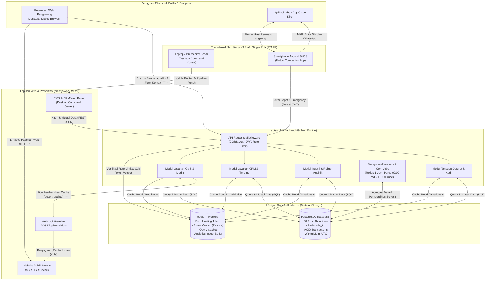

# Cetak Biru Arsitektur Sistem Terintegrasi (Master System Architecture)
**Next Karya Digital Solutions**  
*Spesifikasi Arsitektur Backend Golang, Basis Data PostgreSQL, Cache Redis, Web Next.js, dan Mobile Flutter*  
*Dokumen Versi: 1.0 (Arsitektur Final Multiplatform & High-Performance Core)*  
*Tanggal Berlaku: 31 Oktober 2026*

> [!IMPORTANT]
> **Batasan Lingkup & Hak Akses (Fase 1 vs Fase Berikutnya):**  
> Fase 1 (MVP) dibangun khusus untuk operasional internal tim Next Karya Digital Solutions dengan partisi data tunggal `site_id: "nextkarya-main"` dan satu peran setara (`STAFF`) untuk 3 anggota tim (Staf A - Programmer, Staf B - Desainer, Staf C - Project Lead). Seluruh arsitektur skema database, partisi cache, dan endpoint API telah disiapkan sejak hari pertama untuk mendukung multi-tenant skala besar pada Fase berikutnya (Fase 2) saat portal mandiri klien resmi dirilis.

---

## 1. Ringkasan Eksekutif & 5 Pilar Teknologi Utama

Sistem informasi Next Karya Digital Solutions dirancang menggunakan arsitektur modern terdistribusi (*Decoupled Headless Multiplatform Architecture*). Pemisahan tanggung jawab (*Separation of Concerns*) dilakukan secara tegas untuk menjamin performa tinggi, stabilitas beban puncak, kemudahan pemeliharaan, serta keamanan data tingkat perusahaan.

Lima pilar teknologi yang telah dikunci secara resmi:

1. **Backend Engine: Golang (Go)**
   Bertindak sebagai pusat kendali bisnis (*Single Unified Backend Provider*). Menjalankan server RESTful JSON API `/api/v1`, eksekusi konkuren ringan (*goroutines*), validasi data masukan ketat, proteksi bot/spam berlapis, manajemen transaksi ACID, penjadwalan proses latar belakang (*background cron workers*), serta orkestrasi webhook pembersihan cache.
2. **Database Primer: PostgreSQL**
   Bertindak sebagai satu-satunya sumber kebenaran (*Single Source of Truth*) untuk seluruh data persisten sistem. Menampung 20 tabel entitas relasional dengan partisi `site_id: "nextkarya-main"`, penegakan integritas referensial (*foreign keys*), indeks konkurensi, dan isolasi transaksi level ketat.
3. **Lapisan Akselerasi & Buffer: Redis**
   Bertindak sebagai *In-Memory Data Store* berkecepatan tinggi (latensi mikrodetik). Bertanggung jawab atas pembatasan laju request (*Rate Limiting sliding-window*), verifikasi status sesi instan untuk pemutusan darurat sesi HP hilang (`REVOKE_SESSION`), caching kueri data baca CMS publik, serta penampung buffer sementara event analitik sebelum ditulis ke database.
4. **Frontend Web: Next.js (React, TypeScript, Tailwind CSS, App Router)**
   Melayani dua peran antarmuka komputer (Desktop Web):
   - **Website Profil Publik:** Menampilkan profil perusahaan, katalog layanan, portofolio karya, blog edukasi, formulir kontak, dan pelacak konversi dengan optimasi SEO tinggi dan *Incremental Static Regeneration* (ISR).
   - **Desktop Command Center (Web CMS & CRM):** Pusat kerja tim internal untuk penulisan konten mendalam (*Rich Text Studio*), kurasi portofolio, visualisasi timeline *Gantt Chart* horizontal lebar, grafik tren multi-minggu analitik, dan manajemen *pipeline* prospek penjualan lengkap.
5. **Aplikasi Mobile: Flutter (Dart, Android & iOS)**
   Bertindak sebagai **Action-First Companion & Emergency Toolkit** untuk ketiga staf internal. Berfokus pada kecepatan respon di ponsel pintar (*on-the-go*): halaman agenda *follow-up* hari ini (*due/overdue*), peluncur chat WhatsApp 1-klik ke prospek klien via `url_launcher`, jadwal agenda harian berbentuk kartu vertikal, pantauan kilat 4 angka harian (*pulse check*), serta alat tanggap darurat operasional (*Emergency Toolkit*).

---

## 2. Diagram Topologi & Alur Komunikasi Sistem



---

## 3. Rincian Peran & Tanggung Jawab per Lapisan

### 3.1 Backend Engine (Golang)
Backend Golang berperan sebagai gerbang sentral yang melayani seluruh endpoint RESTful JSON `/api/v1`:

* **Kompilasi Biner Native & Kinerja Tinggi:** Menghasilkan biner tunggal mandiri tanpa dependensi runtime eksternal, dengan jejak memori (*memory footprint*) rendah dan waktu mulai (*startup time*) instan.
* **Model Konkurensi Efisien (*Goroutines & Channels*):** Menangani ribuan request simultan secara paralel, terutama saat menerima semburan beacon analitik (`navigator.sendBeacon`) dan request formulir publik tanpa memblokir thread sistem operasi.
* **Lapisan Autentikasi & Otorisasi:**
  - Menerbitkan dan memvalidasi JSON Web Token (JWT) dengan algoritma HMAC-SHA256.
  - Memeriksa keabsahan `tokenVersion` secara mikrodetik ke Redis pada setiap request terproteksi.
  - Menolak akses jika token kedaluwarsa atau `tokenVersion` pada token lebih rendah dari nilai di Redis/DB (fitur pemutusan sesi darurat HP hilang).
* **Validasi Masukan Baku & Sanitasi:**
  - Seluruh payload request divalidasi ketat menggunakan struct tag validator Go (padanan validasi skema Zod di sisi kontrak).
  - Sanitasi teks terhadap potensi XSS, pemangkasan whitespace, dan penolakan payload liar.
* **Proteksi Bot & Anti-Spam Publik:**
  - Memeriksa field honeypot tersembunyi `website` pada endpoint kontak publik. Request otomatis diabaikan (*silent reject*) jika field terisi.
  - Menghitung batasan laju request berbasis IP menggunakan Redis sliding window:
    - Form kontak publik: Maksimal 5 kiriman per 15 menit per IP.
    - Beacon analitik: Maksimal 60 event per menit per IP.
    - Kueri baca publik: Maksimal 120 request per menit per IP.
* **Pencegahan Konflik Konkurensi (*Optimistic Locking*):**
  - Pada setiap operasi mutasi entitas CMS dan CRM, backend memverifikasi nilai header atau body `updatedAt`.
  - Jika stempel waktu di database telah berubah akibat perubahan oleh rekan tim lain, backend mengembalikan status HTTP `409 Conflict`.
* **Pengelolaan Transaksi ACID (PostgreSQL):**
  - Seluruh mutasi terkait multi-tabel (misal: penambahan catatan prospek sekaligus pembaruan status pipeline dan pembuatan log aktivitas) dibungkus dalam blok `BEGIN ... COMMIT / ROLLBACK`.
* **Pekerja Latar Belakang (*Background Cron Workers*):**
  - **Pukul 02:00 WIB Setiap Hari:** Menjalankan pembersihan rekaman `analytics_events` mentah yang berusia lebih dari 90 hari.
  - **Inkremental Tiap Jam:** Menjalankan rollup analitik dari event mentah ke `analytics_daily` menggunakan CTE `session_summary` yang presisi.
  - **Rolling FIFO 5 Versi:** Memangkas riwayat snapshot konten pada tabel `content_snapshots` agar tepat tersisa maksimal 5 versi terakhir per entitas.
* **Pengiriman Webhook Revalidasi Cache:**
  - Setiap kali ada data konten yang diterbitkan, diperbarui, atau diarsipkan, backend Golang mengirimkan HTTP POST ke endpoint website Next.js `https://nextkarya.id/api/revalidate` dengan header `x-webhook-secret` dan muatan baku:
    ```json
    {
      "tag": "articles",
      "action": "update"
    }
    ```
  - Menjalankan percobaan ulang otomatis sebanyak 3 kali dengan jeda eksponensial (*exponential backoff: 2s, 4s, 8s*) jika koneksi gagal atau timeout.

---

### 3.2 Lapisan Cache & Fast Ingestion (Redis)
Redis difungsikan sebagai perisai (*shield*) di depan PostgreSQL dan akselerator data real-time:

#### Skema Struktur Kunci Redis (*Keyspace Conventions*):

| Pola Kunci Redis | Tipe Data | Waktu Kedaluwarsa (TTL) | Fungsi & Kegunaan |
| :--- | :---: | :---: | :--- |
| `rl:ip:{ip}:{endpoint}` | `String (Counter)` | 60 - 900 detik | *Rate limiting* pembatasan frekuensi request publik per IP. |
| `auth:token_ver:{userId}` | `String (Integer)` | 30 hari | Versi token pengguna aktif. Divalidasi seketika saat verifikasi JWT. |
| `auth:revoked_tokens:{jti}` | `String` | Sisa masa berlaku JWT | Daftar hitam token individual (jika ada pembatalan token spesifik). |
| `cache:cms:{site_id}:services` | `String (JSON)` | 1 jam / On-demand purge | Cache daftar katalog layanan untuk mempercepat response API publik. |
| `cache:cms:{site_id}:faqs` | `String (JSON)` | 1 jam / On-demand purge | Cache daftar FAQ publik aktif. |
| `cache:cms:{site_id}:pricing` | `String (JSON)` | 1 jam / On-demand purge | Cache paket harga layanan publik. |
| `cache:crm:{site_id}:today_summary` | `String (JSON)` | 60 detik | Cache 4 angka ringkasan agenda CRM dan metrik hari ini. |
| `analytics:buffer:{site_id}:{date}` | `List / Stream` | Dikosongkan per interval | Penampung event analitik sebelum proses batch-insert ke PostgreSQL. |

#### Kebijakan Pembersihan Cache (*Cache Invalidation Strategy*):
* **Pembersihan Berbasis Mutasi (*Event-Driven Invalidation*):** Begitu backend Golang mengeksekusi operasi `INSERT`, `UPDATE`, atau `DELETE` pada tabel CMS, kunci cache terkait di Redis langsung dihapus (`DEL`), bersamaan dengan penembakan webhook ke Next.js.
* **Pencabutan Sesi Seketika (`REVOKE_SESSION`):**
  Saat aksi darurat pencabutan sesi dieksekusi, backend menaikkan nilai `auth:token_ver:{userId}` di Redis dengan perintah `INCR` secara atomik, lalu memperbarui kolom `tokenVersion` di PostgreSQL. Seluruh perangkat staf dengan token lama seketika tertolak pada request milidetik berikutnya.

---

### 3.3 Basis Data Relasional (PostgreSQL)
PostgreSQL bertindak sebagai repositori data permanen sistem dengan konfigurasi terstandar:

* **Partisi Data Multi-Tenant (`site_id`):**
  Seluruh 20 tabel entitas sistem memiliki kolom `site_id: "nextkarya-main"` yang terindeks secara ketat. Di Fase 2, arsitektur ini siap menampung data situs klien luar tanpa perombakan skema tabel.
* **Standar Waktu Murni UTC:**
  Seluruh kolom waktu sistem (`createdAt`, `updatedAt`, `publishedAt`, `occurredAt`, `nextFollowUpDate`, `warrantyExpiryDate`) disimpan dalam tipe `TIMESTAMPTZ(3)` berbasis UTC murni (`Z`). Seluruh penyesuaian zona waktu Indonesia Barat (WIB / UTC+7) ditangani di lapisan antarmuka pengguna (Next.js dan Flutter).
* **Indeks Konkurensi & Performa Tinggi:**
  - CRM: Indeks komposit `[site_id, nextFollowUpDate, status, assignedToId]` untuk query agenda follow-up berkecepatan < 10ms.
  - CMS: Indeks komposit `[site_id, status, publishedAt]` dan unique constraint `[site_id, slug]` untuk kueri artikel publik.
  - Analitik: Indeks komposit `[site_id, sessionId, occurredAt]` pada raw events, dan unique composite `[site_id, date, path, source, device]` pada tabel rollup harian.
* **Integritas Relasi (*Referential Integrity*):**
  Seluruh relasi foreign key dilindungi dengan kebijakan `ON DELETE RESTRICT` untuk mencegah terhapusnya entitas induk secara tidak sengaja (misal: kategori artikel tidak dapat dihapus jika masih memuat artikel). Penghapusan konten menerapkan pola *Soft Delete* ke status `ARCHIVED`.

---

### 3.4 Frontend Web (Next.js App Router)
Next.js menjalankan dua peran antarmuka komputer yang memanfaatkan keunggulan App Router:

#### A. Website Profil Publik (`nextkarya.id`):
* **React Server Components (RSC):** Merender halaman secara server-side untuk memastikan skor performa Google Core Web Vitals optimal dan SEO metadata terindeks sempurna oleh mesin pencari.
* **Incremental Static Regeneration (ISR):**
  - Halaman portofolio dan blog di-cache statis di edge/server.
  - Rute Route Handler `app/api/revalidate/route.ts` menerima sinyal webhook dari backend Golang:
    ```typescript
    export async function POST(request: NextRequest) {
      const secret = request.headers.get("x-webhook-secret");
      if (secret !== process.env.REVALIDATION_SECRET) {
        return NextResponse.json({ message: "Akses ditolak" }, { status: 401 });
      }
      const body = await request.json();
      if (body.action === "update" && body.tag) {
        revalidateTag(body.tag);
        return NextResponse.json({ revalidated: true, now: Date.now() });
      }
      return NextResponse.json({ message: "Payload tidak valid" }, { status: 400 });
    }
    ```
  - Cache halaman publik terhapus dan terbarui dalam waktu kurang dari 3 detik tanpa jeda.

#### B. Desktop Command Center (Web CMS & CRM):
* **Workspace Khusus Komputer:** Dikhususkan untuk layar lebar desktop (resolusi >= 1280px).
* **Studio Penulisan Konten:** Editor teks kaya (*Rich Text / Markdown Editor*), pratinjau split-screen desktop vs mobile, pengelola unggah media multi-gambar, dan pemulihan snapshot riwayat FIFO 5 versi.
* **Gantt Chart Timeline Proyek:** Tampilan diagram balok horizontal melintasi multi-minggu untuk menata beban alokasi tugas ketiga staf secara visual.
* **Dashboard Analitik Komprehensif:** Grafik tren multi-minggu, matriks halaman terpopuler, perbandingan saluran rujukan (Google vs Media Sosial), dan rasio konversi WhatsApp.

---

### 3.5 Aplikasi Mobile (Flutter Companion)
Aplikasi mobile dibangun dengan framework Flutter (Dart) sebagai alat aksi cepat tim internal:

* **Satu Basis Kode (*Single Codebase*):** Dikompilasi secara native ke berkas APK/AAB Android dan IPA iOS dengan performa rendering halus 60 frame per detik (fps).
* **Arsitektur State Management Bersih (*Clean Architecture + Riverpod / BLoC*):**
  Memisahkan antara lapisan presentasi (*Widgets*), logika bisnis (*Controllers / Notifiers*), dan penyedia data (*Repositories / API Clients*).
* **Koneksi REST API Golang:**
  Mengonsumsi endpoint `/api/v1` dengan HTTP client teroptimasi (`dio` package) yang menyertakan interceptor penyemat token `Authorization: Bearer <token>` dan penanganan error terpusat.
* **Keamanan Penyimpanan Lokal:**
  Menggunakan `flutter_secure_storage` yang memanfaatkan *Android Keystore* dan *Apple Keychain* untuk mengenkripsi token JWT pada ponsel staf.
* **Fitur Respon Cepat & Emergency:**
  - **Halaman Agenda Follow-Up Hari Ini:** Menampilkan prospek yang jatuh tempo hari ini (*due*) atau terlambat (*overdue*).
  - **1-Tap WhatsApp Launcher:** Menggunakan package `url_launcher` untuk membuka percakapan WhatsApp resmi ke nomor prospek calon klien seketika tanpa jeda.
  - **Emergency Toolkit Mobile:** Tombol 1 sentuhan untuk menurunkan konten sensitif (*Emergency Unpublish*), sakelar darurat kunci form kontak saat serangan spam, sakelar banner pengumuman darurat, serta pengalihan penanggung jawab prospek darurat saat staf berhalangan.

---

## 4. Matriks Pembagian Tugas Antar-Platform

| Domain Fitur | Backend Golang | Database Postgres & Redis | Frontend Web Next.js | Mobile Flutter App |
| :--- | :--- | :--- | :--- | :--- |
| **Autentikasi & Sesi** | • Penerbitan JWT<br>• Verifikasi tokenVersion | • Postgres: Simpan passwordHash<br>• Redis: Cek versi token O(1) | • Form login desktop<br>• Penyimpanan cookie sesi aman | • Form login mobile<br>• Secure Storage ponsel |
| **Tanggap Darurat (Revoke)** | • Logika endpoint revoke<br>• Naikkan tokenVersion | • Redis: INCR tokenVersion<br>• Postgres: Catat audit entitas USER | • Tampilan audit log darurat di dashboard desktop | • Tombol aksi darurat putus sesi HP hilang |
| **Katalog Konten (CMS)** | • Validasi Zod/Struct<br>• Optimistic Locking check<br>• Picu Webhook Revalidate | • Postgres: 10 tabel CMS, FIFO 5 snapshot<br>• Redis: Cache daftar kueri publik | • Desktop: Studio editor, pratinjau konten<br>• Publik: ISR render & SEO | • Pemantauan status terbit<br>• 1-Tap Emergency Unpublish |
| **Prospek & Timeline (CRM)** | • Validasi Zod prospek<br>• Anti-spam bot honeypot<br>• Hitung beban tugas staf | • Postgres: Tabel leads, notes, activities, projects, milestones | • Desktop: Visual pipeline penjualan & Gantt Chart lebar | • **Agenda Follow-Up Hari Ini**<br>• **1-Klik Chat WhatsApp**<br>• Kartu tugas harian vertikal |
| **Trafik & Metrik (Analitik)** | • Intake beacon pelacak<br>• Rollup inkremental harian<br>• Cron purge data > 90 hari | • Postgres: Raw events (TTL 90 hari) & Daily Rollup | • Desktop: Grafik tren multi-minggu & analisis saluran | • Sekilas 4 angka metrik hari ini (*Quick Pulse Check*) |
| **Proteksi Spam & Rate Limit** | • Evaluasi honeypot<br>• Penolakan bot otomatis | • Redis: Token bucket rate limiting per IP | • Tampilan form publik aman | • Notifikasi internal & sakelar kunci form darurat |

---

## 5. Protokol Komunikasi & Format Data

### 5.1 Format Respons Tunggal (*Single Envelope Pattern*)
Seluruh komunikasi API antara backend Golang, frontend Next.js, dan aplikasi mobile Flutter menggunakan format amplop JSON seragam:

```json
{
  "success": true,
  "data": { ... },
  "meta": {
    "page": 1,
    "limit": 20,
    "totalRows": 105,
    "totalPages": 6
  },
  "error": null
}
```

Format respons gagal (*Error Response*):
```json
{
  "success": false,
  "data": null,
  "meta": null,
  "error": {
    "code": "VALIDATION_ERROR",
    "message": "Input data tidak valid.",
    "details": [
      {
        "field": "phoneNumber",
        "message": "Nomor WhatsApp wajib diawali format 62 atau 08."
      }
    ]
  }
}
```

### 5.2 Standar Kode Status HTTP
* `200 OK`: Permintaan berhasil diproses.
* `201 Created`: Entitas baru berhasil dibuat (misal: lead baru atau upload media).
* `400 Bad Request`: Validasi skema input gagal (dengan rincian field pada objek `error.details`).
* `401 Unauthorized`: Token tidak disertakan atau telah kedaluwarsa.
* `403 Forbidden`: Token valid namun hak akses tidak mencukupi.
* `404 Not Found`: Entitas ID atau rute tidak ditemukan.
* `409 Conflict`: Konflik stempel waktu konkurensi (*Optimistic Locking* `updatedAt`).
* `429 Too Many Requests`: Batasan frekuensi request (*Rate Limit*) terlampaui. Disertai header `Retry-After`.
* `500 Internal Server Error`: Kesalahan internal pada server Golang.

---

## 6. Standar Kinerja, Toleransi & Service Level Agreement (SLA)

Untuk menjamin kenyamanan operasional ketiga anggota tim, arsitektur ini mematok standar performa teknis:

1. **Latensi API Backend Golang:**
   - Kueri baca ter-cache di Redis: **< 15 milidetik**.
   - Kueri baca kompleks ke PostgreSQL: **< 60 milidetik**.
   - Operasi penulisan transaksi database: **< 120 milidetik**.
2. **Pembersihan Cache Website Publik Next.js:**
   - Webhook revalidasi cache wajib tuntas dalam waktu **< 3 detik** sejak tombol terbit/simpan ditekan di CMS.
3. **Eksekusi Tindakan Darurat Mobile (*Emergency Toolkit*):**
   - Waktu dari tombol aksi darurat ditekan di Flutter hingga konten turun atau form terkunci di database: **< 2 detik**.
4. **Kinerja Render Aplikasi Mobile Flutter:**
   - Menjaga laju bingkai antarmuka konsisten pada **60 frame per detik (fps)** tanpa freeze atau lag.
5. **Ukuran Skrip Pelacak Analitik di Browser:**
   - Bobot skrip pelacak publik: **< 2 Kilobyte (KB)** gzip, memicu pengiriman event via `navigator.sendBeacon` secara asinkron tanpa memperlambat waktu muat website profil.

---

## 7. Roadmap Transisi Menuju Fase 2 (Kesiapan Multi-Tenant Klien)

Arsitektur Fase 1 (MVP) sengaja mengunci akses hanya untuk internal Next Karya dengan `site_id: "nextkarya-main"`. Fondasi sistem ini telah dirancang siap bertransisi ke Fase 2 tanpa merombak ulang inti backend:

1. **Multi-Tenancy Penuh:**
   Penyediaan `site_id` baru untuk klien eksternal (contoh: `site_id: "klien-sekolah-01"`).
2. **Portal Mandiri Klien (*Client Self-Service Portal*):**
   Sub-domain antarmuka web Next.js khusus klien untuk memantau progres pengerjaan proyek dan statistik pengunjung situs mereka sendiri.
3. **Manajemen Sesi Lanjutan Berbasis Redis:**
   Pemantauan daftar perangkat aktif pengguna (*Device Session Manager*) dengan kapabilitas pencabutan izin akses perangkat secara individual.
4. **Push Notification Native:**
   Integrasi Firebase Cloud Messaging (FCM) dan Apple Push Notification service (APNs) pada aplikasi Flutter untuk pengiriman peringatan prospek baru dan tenggat follow-up secara real-time.
5. **Penjadwalan Terbit Otomatis (*Scheduled Publishing*):**
   Worker terjadwal di Golang untuk mempublikasikan draf konten secara otomatis pada tanggal dan jam mendatang.

---

## 8. Riwayat Pembaruan Dokumen (*Changelog*)

### Versi 1.0 (31 Oktober 2026)
* Penyusunan cetak biru resmi arsitektur sistem terintegrasi (*Master System Architecture*).
* Menetapkan dan mengunci 5 pilar teknologi resmi: Backend Golang, Basis Data PostgreSQL, Lapisan Akselerasi Redis, Frontend Web Next.js, dan Mobile Flutter.
* Menyusun diagram topologi sistem terintegrasi lengkap menggunakan format Mermaid.
* Merinci arsitektur kunci Redis (*keyspace*), strategi pembatasan laju request (*rate limiting*), dan mekanisme pencabutan darurat sesi HP hilang O(1).
* Mengunci alur webhook revalidasi cache ke Next.js dengan muatan baku `"action": "update"` dan toleransi retry eksponensial.
* Menyusun matriks pembagian tugas antarmuka Desktop Command Center vs Mobile Flutter Companion.
* Menetapkan standar kriteria performa SLA untuk seluruh komponen sistem.
